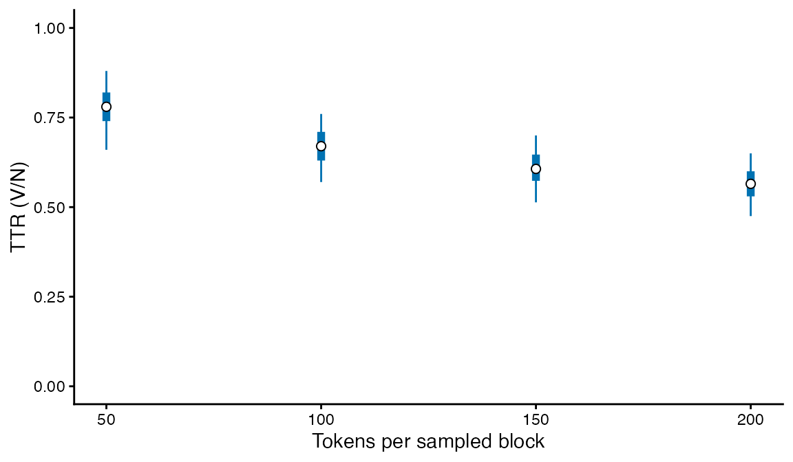
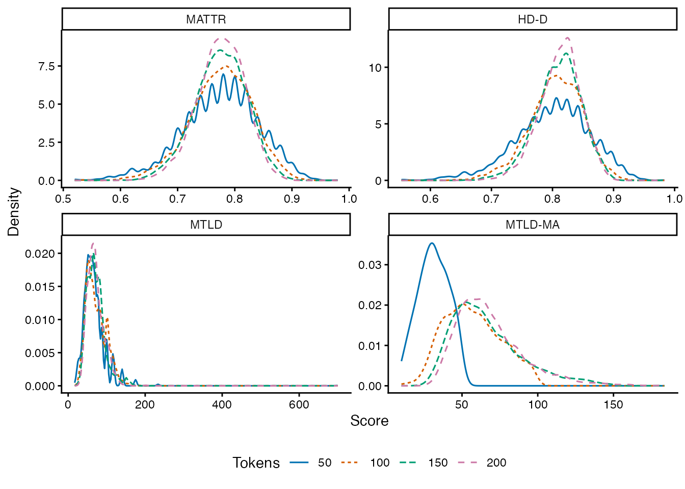
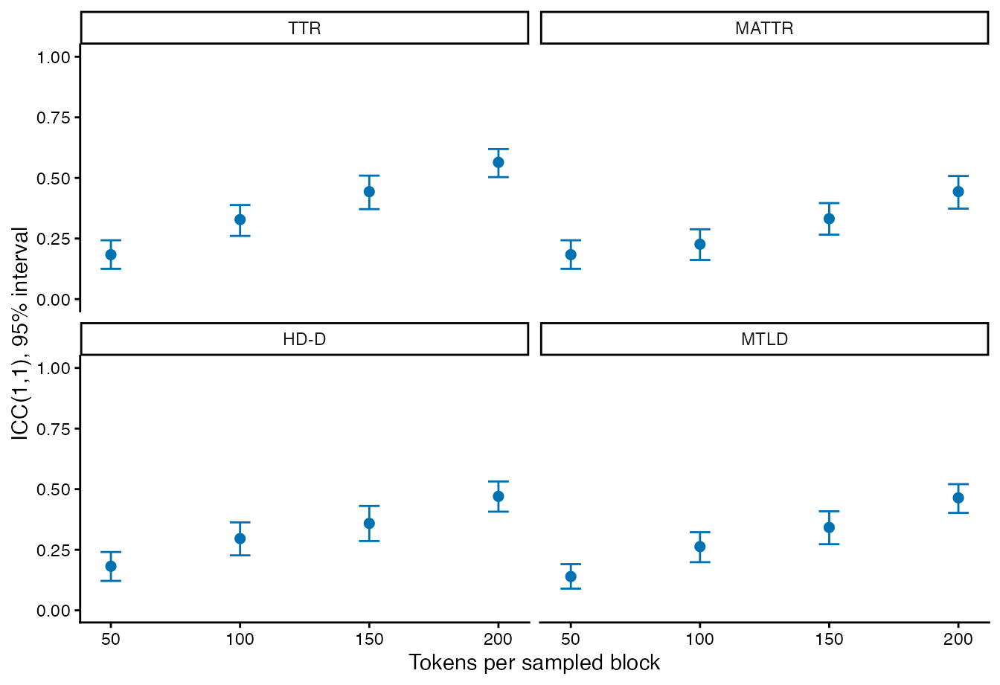
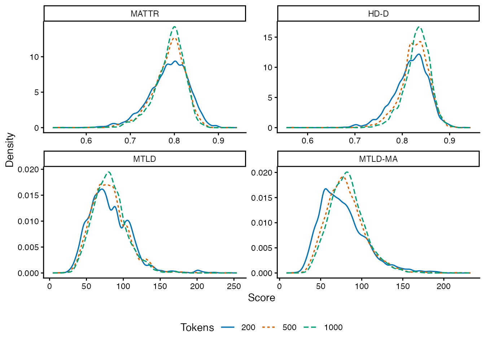

# Choosing a lexical-diversity measure

## Choose the property you want to measure

**For local lexical variety, start with MATTR at a fixed window size.**
The evidence below supports this starting choice for English
surface-word analyses at window 50; other languages, word units and
windows need their own checks. Use HD-D at a fixed sample size when you
want a summary of the whole text’s frequency distribution that ignores
word order. Use MTLD when sequential factor lengths answer your question
or a study you are extending used the same definition. None of these
choices, by itself, turns word counts into a measure of vocabulary
knowledge or writing quality.

Being able to compute a score is a separate question from having enough
text for the intended comparison. At window 50, a 50-token MATTR score
is just one window’s TTR. Even at 100 tokens, the corpus results below
do not support precise individual ranking. Group comparisons should
retain writer/task structure and sampling uncertainty; averaging does
not remove systematic differences in topics or text coverage.

| Question or constraint | Choice | Conditions that matter |
|----|----|----|
| How varied is vocabulary within local stretches? | `mattr`, fixed `window_length` | Fix the window across texts. Texts below the window produce no score. Changing the window changes the property measured. |
| How diverse is the text’s frequency distribution? | `hdd`, fixed `sample_size` | Fix the sample size. Order is ignored. Topic expansion and unequal coverage can still affect the result. |
| How long does a sequence maintain lexical variety? | `mtld`, fixed threshold | Inspect completed factors and tail contribution; short texts may be dominated by the tail calculation. Record the exact method ID. |
| Reproduce koRpus’s moving-average MTLD? | Explicit `mtld_ma` | This is a separate forward, overlapping, complete-factor method. It is often unavailable or strongly selected in short texts. |
| Compare type counts at exactly the same length? | `ttr` with a controlled sampling design | Preserve document and writer boundaries. A common length does not guarantee a reliable individual score. |
| Reproduce an existing segment-based study? | `msttr`, fixed segment length | Incomplete final segments are dropped; segment boundaries matter. |
| Study repetition/concentration? | `yule_k` | Lower values indicate less concentration. This answers a different question from rare-word knowledge or local sequence variety. |

Do not select RTTR, CTTR, Herdan’s C, Maas or Yule’s I simply because a
formula adjusts TTR or uses logarithms. Their length behavior must suit
the comparison. The experimental `expected_ttr_d` fits an exact
expected-TTR curve; it is not CLAN VOCD and is excluded from default
computations.

## Why these recommendations?

Covington and McFall (2010) define MATTR through a fixed moving window.
This makes the unit of local comparison explicit, and allows variation
inside a text to be inspected. It does not make different window sizes
interchangeable. [Original
method](https://doi.org/10.1080/09296171003643098).

Fergadiotis, Wright and Green (2015) compared four measures in discourse
from 442 adults. Their modeling supported MTLD and MATTR more strongly
than D and Maas with respect to length-related method variance. These
were monolingual adult spoken samples in four discourse tasks, so that
result is useful evidence, not a universal ranking for learner writing
or other languages.
[Study](https://doi.org/10.1044/2015_JSLHR-L-14-0280).

Zenker and Kyle (2021) examined 4,542 L2 argumentative essays at lengths
of 50–200 tokens. MATTR and versions of MTLD were relatively stable,
whereas TTR did not stabilize in that range. Their comparison also
considered prompt and proficiency. This supports inspecting length and
task together; a minimum computational length is not a universal
precision threshold. Its moving-average MTLD variants also differ from
this package’s forward, non-wrapping `mtld_ma`; their results do not
validate that implementation.
[Study](https://doi.org/10.1016/j.asw.2020.100505).

Our package evaluation adds direct evidence for the implemented
definitions in learner essays, academic assignments, general writing and
conversation. It asks two separate questions: does a score shift as more
of the same text is included, and does it agree across different sampled
parts of that text? The second question matters even when the average
score has little length dependence.

## Read a TTR plot as a length-dependent description

TTR is `V/N`, not a score with an inherent “higher is better”
interpretation. These authored sequences have the same four types;
repeating the sequence four times changes TTR from .20 to .05. The blank
document has no TTR. This illustrates the denominator, not a finding
about writers.

``` r
documents <- list(short = rep(letters[1:4], 5), empty = character(),
  long = rep(letters[1:4], 20))
ttr <- lexdiv_metrics_batch(documents, metrics = "ttr")
local({
  old <- par(mfrow = c(1, 2), mar = c(4.5, 4.3, 1, .5))
  on.exit(par(old))
  plot(ttr, cex = 1.2)
  ok <- ttr$status == "ok" & is.finite(ttr$value)
  plot(ttr$N[ok], ttr$value[ok], xlab = "Tokens (N)", ylab = "TTR (V/N)",
    ylim = c(0, 1), pch = 19, col = "#0072B2", bty = "l", las = 1)
})
```


The left plot retains the document roster and shows `N`; “not computed”
is not a zero. Its invisible return includes the missing row and its
reason. The right plot checks score against length. Neither plot adjusts
for length. With real data, distinguish tasks/registers by panels or
symbols and retain writer IDs. A pooled association can reflect
differences between tasks, writers or sampling conditions; it is not an
isolated estimate of length bias. Use a controlled-length design for
that question, as below. A blue TTR point indicates a computed value,
not adequate sampling precision.

For many documents, replace the crowded document axis with
individual-score distributions within comparable task/length strata. Use
points for small samples or discrete values. With sufficient continuous
observations, overlay densities using a common bandwidth and range
within each measure, and report the observed and missing counts beside
them. Different density heights or overlap alone do not establish a
group effect. Keep paired writer trajectories when the question concerns
change; connecting unrelated documents fabricates a longitudinal
pattern.

For local variation within one text, use
`plot(lexdiv_mattr_profile(...))` with one explicit window request.
Adjacent windows overlap; their spread is not a confidence interval and
their count is not an independent sample size. For lexical frequency or
norms, see the separate [value-distribution and coverage
example](https://ryuya-dot-com.github.io/ldfreq/articles/corpus-reference-profiles.html#visualize-values-and-coverage-together).

## Evidence from 2,786 PELIC essays

The evaluation uses the fixed [PELIC v1.0
corpus](https://doi.org/10.5281/zenodo.3991977), original responses to
essay questions in writing classes, retaining the first response per
writer and prompt. This gives **2,786 essays, 696 writers, 297 prompts
and 1,196,348 tokens**. Tokenization uses the package’s English rules,
NFC, lower case, surface words, and excludes numbers; spelling errors
remain. Source file hashes and selection code are recorded in the
[reproduction
directory](https://github.com/Ryuya-dot-com/ldfreq/tree/v0.5.0.9001/experiments/corpus-stability).

For the controlled-length comparison, the same **1,330 essays from 421
writers** with at least 400 tokens contribute at every length. Each
essay supplies a uniformly selected pair of disjoint 200-token blocks.
Nested prefixes give 50-, 100-, 150- and 200-token samples without
reordering words. MATTR/MSTTR use 50, HD-D uses 42, and both MTLD
methods use a strict threshold of .72. Selection and analysis were
specified before examining metric outcomes.

### Length sensitivity

These are means of all available block scores, with two sampled blocks
per essay. An essay with only one computable block contributes only that
block. MTLD-MA therefore has a changing observed subset; its missing
counts must be read alongside its means. Paired length changes below
instead require both blocks at both lengths to be computable and weight
eligible essays equally.

| Measure | Tokens |    Mean | Computed blocks | Missing blocks |
|:--------|-------:|--------:|----------------:|---------------:|
| ttr     |     50 |  0.7749 |            2660 |              0 |
| ttr     |    100 |  0.6692 |            2660 |              0 |
| ttr     |    150 |  0.6068 |            2660 |              0 |
| ttr     |    200 |  0.5631 |            2660 |              0 |
| msttr   |     50 |  0.7749 |            2660 |              0 |
| msttr   |    100 |  0.7749 |            2660 |              0 |
| msttr   |    150 |  0.7754 |            2660 |              0 |
| msttr   |    200 |  0.7761 |            2660 |              0 |
| mattr   |     50 |  0.7749 |            2660 |              0 |
| mattr   |    100 |  0.7758 |            2660 |              0 |
| mattr   |    150 |  0.7751 |            2660 |              0 |
| mattr   |    200 |  0.7759 |            2660 |              0 |
| mtld    |     50 | 66.9529 |            2660 |              0 |
| mtld    |    100 | 72.3674 |            2660 |              0 |
| mtld    |    150 | 71.5452 |            2660 |              0 |
| mtld    |    200 | 71.4649 |            2660 |              0 |
| mtld_ma |     50 | 31.1869 |             673 |           1987 |
| mtld_ma |    100 | 57.0482 |            2215 |            445 |
| mtld_ma |    150 | 66.3737 |            2623 |             37 |
| mtld_ma |    200 | 68.3238 |            2659 |              1 |
| hdd     |     50 |  0.8005 |            2660 |              0 |
| hdd     |    100 |  0.8054 |            2660 |              0 |
| hdd     |    150 |  0.8095 |            2660 |              0 |
| hdd     |    200 |  0.8124 |            2660 |              0 |

For TTR, the points show medians, thick ranges the 25th–75th
percentiles, and thin ranges the 5th–95th percentiles of the saved block
scores. All four lengths include the same 1,330 essays and 2,660 blocks,
with no missing TTR. These ranges describe the distribution of original
scores, **not confidence intervals**. The downward shift cannot be
attributed to a changing essay cohort. The samples are prefixes of the
same blocks, so this display is not four independent groups and does not
estimate a writer’s development.



The curves show the original values at each length, using a common
bandwidth and evaluation range within each measure. MTLD-MA curves
include only computable blocks; the missing counts above identify the
changing subset.



MATTR’s mean changed from .7749 to .7759. Its paired 200-minus-50 change
was .00106, with a writer-cluster bootstrap 95% interval of −.00110 to
.00326. MSTTR showed a similarly small average shift. This supports
their use for length-heterogeneous local-variety comparisons at these
settings.

HD-D increased from .8005 to .8124 despite keeping the sample size at
42; its paired change was .01192 \[.00997, .01396\]. MTLD increased from
66.95 to 71.46, a paired change of 4.51 \[3.52, 5.52\]. At 50 tokens,
80.3% of MTLD blocks had no complete factor in at least one direction. A
numeric output alone therefore does not establish that the text supports
the intended sequential interpretation.

TTR fell from its 50-token level by .2118 \[−.2145, −.2090\]. On a
common standardized scale, RTTR, CTTR, Herdan, Maas and Yule’s I also
showed substantial changes. The downloadable paired-change table reports
every tested measure, including signs and intervals, rather than
selecting only favorable results.

### Sampling reliability

Here reliability means **ICC(1,1) for one sampled block**, treating the
two random blocks as exchangeable measurements of an essay. It estimates
the share of score variation associated with differences between essays
rather than the sampled position inside an essay. It is not test–retest
reliability of a writer’s ability, nor reliability of an average of two
blocks.

| Measure | Tokens | Complete pairs |    ICC | 95% lower | 95% upper |
|:--------|-------:|---------------:|-------:|----------:|----------:|
| msttr   |     50 |           1330 |  0.183 |     0.125 |     0.243 |
| msttr   |    200 |           1330 |  0.440 |     0.374 |     0.500 |
| mattr   |     50 |           1330 |  0.183 |     0.125 |     0.243 |
| mattr   |    200 |           1330 |  0.444 |     0.373 |     0.508 |
| mtld    |     50 |           1330 |  0.140 |     0.090 |     0.191 |
| mtld    |    200 |           1330 |  0.464 |     0.402 |     0.521 |
| mtld_ma |     50 |            105 | -0.009 |    -0.215 |     0.161 |
| mtld_ma |    200 |           1329 |  0.387 |     0.319 |     0.453 |
| hdd     |     50 |           1330 |  0.182 |     0.121 |     0.241 |
| hdd     |    200 |           1330 |  0.470 |     0.407 |     0.532 |

The following inferential display reuses the saved estimates and
intervals; it does not treat the blocks or overlapping windows as
independent bootstrap units. Each panel shows the original ICC at each
length, on the same scale. TTR is included to distinguish its strong
length effect from its within-length sampling agreement. MTLD-MA is kept
in the table because its usable subset changes sharply across lengths.



MATTR at 200 tokens had ICC .444 \[.373, .508\]; HD-D .470 \[.407,
.532\]; MTLD .464 \[.402, .521\]. At 50 tokens all three were around
.14–.18. Thus, **small mean length effects do not justify precise
ranking of individual essays from a short excerpt**. Use more
representative text, report sampling uncertainty, and use multiple tasks
or occasions when your claim concerns a writer rather than this essay.
The point estimates do not establish a meaningful reliability advantage
of HD-D or MTLD over MATTR.

Intervals use 2,000 bootstrap samples of writers, keeping each writer’s
essays together. The estimand weights essays equally and is conditional
on these prompts; it is not a probability sample of all learner writing.
Topic differences can increase between-essay variation. Longer-essay
selection, the two-block sampling design and fixed parameters limit
generalization. These limitations describe what was estimated; they do
not replace the numerical evidence.

### MTLD-MA and short texts

`mtld_ma` starts at each successive token, finds the first complete
factor, and averages retained lengths of at least 10. It stops when a
start cannot complete a factor, uses no reverse pass and gives no
fractional tail credit. This corresponds to koRpus `min.tokens = 9` and
`MTLDMA.steps = 1`. A factor closing before ten tokens is excluded, not
extended to ten. [koRpus `lex.div()`
documentation](https://CRAN.R-project.org/package=koRpus).

At 50 tokens, **1,987 of 2,660 blocks (74.7%) had no retained factor**.
Only 105 essays had two usable blocks, compared with 1,329 at 200
tokens. The 50-token mean and reliability describe that selected subset.
For this reason MTLD-MA is opt-in and is not recommended as the sole
outcome for short responses. Reducing its minimum factor length to
rescue missing values would change the method.

``` r
tokens <- rep(letters[1:20], 8)
lexdiv_metrics(tokens, metrics = c("mtld", "mtld_ma"))[
  c("metric_id", "value", "status", "diagnostics")]
#> <lexdiv_results: 2 metrics; contract unknown>
#>   metric_id value status mtld_tail_only mtld_gap_pct
#> 1      mtld    32     ok          FALSE            0
#> 2   mtld_ma    28     ok             NA           NA
#> MTLD gap (%): absolute forward/reverse difference / their mean; not a precision estimate.
```

## Evidence across ICNALE, OANC and BAWE

The extension uses **5,600 ICNALE WE 2.6 essays, 8,824 OANC documents
and 2,761 BAWE assignments** as its starting inventory. BAWE’s primary
analysis requires a recorded single author; multiple/unknown authors are
excluded. Complete duplicate token sequences are removed after this
eligibility rule. ICNALE L2 essays and L1 reference essays are analyzed
separately. OANC conversations contain multiple speakers and are not
treated as individual writers. The [protocol and reproduction
scripts](https://github.com/Ryuya-dot-com/ldfreq/tree/v0.5.0.9001/experiments/corpus-extension)
record source hashes, extraction, exclusions and all twelve measures’
results.

The short-text cohort supplies two disjoint 100-token blocks per
document, evaluated at nested lengths 50 and 100. The long-text cohort
supplies two disjoint 1,000-token blocks, evaluated at 200, 500 and
1,000. Each comparison keeps the same documents across its lengths.
**The two cohorts are different; their curves must not be joined into a
single length trajectory.** Parameters and English tokenization match
the PELIC experiment. BAWE uses body text, excluding notes, front/back
matter, tables, figures and formula placeholders; quotations remain. No
spelling corrections or token shuffling are performed.

| Population | Short-text documents (N ≥ 200) | Long-text documents (N ≥ 2,000) |
|----|---:|---:|
| ICNALE L2 | 4,933 | — |
| ICNALE L1 reference | 395 | — |
| OANC written | 6,369 | 1,216 |
| OANC spoken | 2,397 | 278 |
| BAWE single-author assignments | 2,636 | 1,339 |

### What changes the choice of measure?

**MATTR at window 50 remains a useful starting choice for local lexical
variety under these English tokenization and sampling conditions.** Its
mean shifts were comparatively small in both cohorts. From 200 to 1,000
tokens, the paired mean change was −.00219 in OANC writing and +.00225
in BAWE, with 95% cluster-bootstrap intervals \[−.00355, −.00092\] and
\[.00108, .00346\]. These correspond to −.070 and +.071 SD, where the
denominator is the SD of documents’ two-block mean scores at 1,000
tokens in the complete-case comparison. The shifts are small relative to
that variation but are detectably nonzero and have opposite directions;
the result is not exact length invariance.

HD-D increased by .01757 \[.01636, .01878\] in OANC writing and .01392
\[.01276, .01502\] in BAWE over the same lengths, corresponding to .771
and .566 SD on the same standardization rule. Fixing its sample size at
42 does not eliminate the effects of adding different stretches of text
to the frequency distribution. Choose HD-D for that distributional
target; do not choose it solely to remove text-length effects.

MTLD’s standardized 200-to-1,000 change was −.079 in OANC writing and
.029 in BAWE, but its 50-to-100 change was much larger in writing (.547
in OANC, .346 in BAWE, .172 in ICNALE L2). A result for long documents
does not justify the same interpretation for short responses. MTLD-MA
still had 71.0% missing 50-token blocks in ICNALE L2, 77.3% in BAWE and
91.1% in OANC writing. Its short-text means describe a strongly selected
subset.

These experiments vary contiguous sample length within eligible
documents. They do not establish that scores from arbitrary whole
documents are interchangeable across lengths, genres or populations.
Retain full document lengths and test sensitivity within the comparison
you intend to make, rather than applying the observed changes as
universal correction factors.

The BAWE curves below show the distributions at each long-cohort length,
using a common bandwidth and evaluation range within each measure.
Missing blocks are omitted from density estimation, not replaced with
zero.



### Mean stability and individual-score stability differ

The following MATTR ICCs concern one sampled block at window 50.
Intervals use 2,000 bootstrap replicates of linked writers/source units,
preserving all documents and blocks in a sampled cluster.

| Corpus | Tokens | Documents |   ICC | 95% lower | 95% upper |
|:-------|-------:|----------:|------:|----------:|----------:|
| icnale |    100 |      4933 | 0.404 |     0.375 |     0.430 |
| oanc   |    100 |      6369 | 0.258 |     0.213 |     0.301 |
| oanc   |    200 |      1216 | 0.296 |     0.236 |     0.354 |
| oanc   |    500 |      1216 | 0.485 |     0.430 |     0.535 |
| oanc   |   1000 |      1216 | 0.608 |     0.568 |     0.647 |
| bawe   |    100 |      2636 | 0.354 |     0.313 |     0.393 |
| bawe   |    200 |      1339 | 0.429 |     0.374 |     0.479 |
| bawe   |    500 |      1339 | 0.599 |     0.552 |     0.641 |
| bawe   |   1000 |      1339 | 0.729 |     0.689 |     0.763 |

At 100 tokens, MATTR’s ICC was .404 in ICNALE L2, .258 in OANC writing
and .354 in BAWE. Its small mean length effect therefore does not
justify precise individual ranking from 100 words. At 1,000 tokens the
point estimates rose to .608 in OANC writing and .729 in BAWE, in
different, longer-document cohorts. This comparison is not a
within-cohort estimate of the gain from 100 to 1,000. Within the same
long-text cohorts, the 200/500/1,000-token ICCs were .296/.485/.608 for
OANC writing and .429/.599/.729 for BAWE. This directly shows the
improvement with more representative text within the evaluated range; it
does not establish a universal minimum number of words.

The pooled BAWE value also reflects disciplinary/genre differences. At
1,000 tokens its discipline-specific MATTR ICCs were .625–.710; the OANC
technical stratum was .512. Some small genre strata had negative
estimates or too few independent clusters for intervals. All strata are
retained in the result tables.

OANC uncertainty requires particular care. Shared Switchboard speakers
link its conversations into one connected component. In the pooled short
spoken cohort that component accounts for 96.1% of documents; a nominal
cluster interval there is fragile despite the count of 2,397
conversations. Long spoken data have only 17 components, so intervals
are withheld under the predeclared minimum of 20. These data provide
descriptive sampling evidence, not a precise population reliability
estimate for speech.

### Agreement across ICNALE tasks

For writers with both eligible essays, independently sampled 200-token
segments compare the part-time-job and smoking prompts. The L2 subset
contains 2,361 writers. MATTR’s Lin concordance coefficient was **.494
\[.460, .527\]**, with Spearman correlation .461. HD-D, MTLD and MTLD-MA
had concordance .490, .436 and .430, respectively. In the smaller L1
reference subset, MATTR concordance was .179 \[.047, .309\]. Agreement
depends on the population’s variability and the prompts; a coefficient
is not a property of the formula alone.

These are agreement estimates for two fixed tasks, including possible
mean differences, not the within-essay ICC or a general reliability of
vocabulary ability. A study making claims about writers needs repeated
tasks/occasions and a measurement design appropriate to those claims.

## Does the implementation agree with external tools?

Actual koRpus 0.13-9 calls were run on **202 real essays**, selected
across recorded course levels and length quartiles, with at least 50
tokens. A supplied token table bypassed its raw-character
retokenization, and the retained token vector was checked for identity.
TTR, MATTR, HD-D on the expected-TTR scale, MTLD, and MTLD-MA agreed
within 1e-10 wherever computable. MTLD-MA was missing in the same two
essays in both implementations.

| metric | documents | comparable | missing_disagreements | matches_1e_10 | max_abs_difference |
|:---|---:|---:|---:|---:|---:|
| hdd | 202 | 202 | 0 | 202 | 0 |
| mattr | 202 | 202 | 0 | 202 | 0 |
| mtld | 202 | 202 | 0 | 202 | 0 |
| mtld_ma | 202 | 200 | 0 | 200 | 0 |
| ttr | 202 | 202 | 0 | 202 | 0 |

The existing nine authored boundary sequences remain useful: they expose
a terminal two-token difference in ordinary MTLD that did not occur in
this real-text subset. The external comparison tests computational
correspondence; the length and sampling analyses above provide different
evidence for choosing a measure. Neither comparison establishes
proficiency validity.

The three-corpus extension adds **182 real blocks at 50–1,000 tokens**.
All jointly computable values of the same five measures agreed within
1e-10. There were 40 documented MATTR availability differences: with
window 50, koRpus 0.13-9 returns NA at exactly 50 tokens, whereas ldfreq
returns the TTR of the single valid window. Inspection of the installed
implementation and 49/50/51/52-token checks confirmed this boundary
rule. The result tables preserve these disagreements; they are not
reported as complete agreement.

## Data acknowledgements

ICNALE: Ishikawa, S. (2023). *The ICNALE Guide: An Introduction to a
Learner Corpus Study on Asian Learners’ L2 English*. Routledge. [Corpus
documentation and citation
requirements](https://language.sakura.ne.jp/icnale/index.html). OANC
data and documentation are provided by the [Open American National
Corpus project](https://anc.org/data/oanc/).

The data in this study come from the British Academic Written English
(BAWE) corpus, which was developed at the Universities of Warwick,
Reading and Oxford Brookes under the directorship of Hilary Nesi and
Sheena Gardner (formerly of the Centre for Applied Linguistics
\[previously called CELTE\], Warwick), Paul Thompson (Department of
Applied Linguistics, Reading) and Paul Wickens (Westminster Institute of
Education, Oxford Brookes), with funding from the ESRC
(RES-000-23-0800). [BAWE project and
conditions](https://www.coventry.ac.uk/research/research-directories/current-projects/2015/british-academic-written-english-corpus-bawe/).

## Specify and report your decision

1.  Define the target: local word variety, frequency-distribution
    diversity, repetition, or a specific published construct.
2.  Fix tokenization, word unit, window/sample size and method
    definition before comparing groups. Do not silently shorten windows
    for short documents.
3.  Keep original lengths and missing results. Check a controlled-length
    sensitivity analysis within your own design, preserving writers and
    tasks.
4.  Report the package version, method ID, parameters, included/excluded
    counts, and the sampling or repeated-task evidence relevant to your
    claim.

Use [study
tables](https://ryuya-dot-com.github.io/ldfreq/articles/repeated-observations.md)
to retain writer, task and occasion identities and pass the resulting
table to an appropriate statistical model. Use [comparison
design](https://ryuya-dot-com.github.io/ldfreq/articles/designing-comparisons.md)
for window, order and preprocessing sensitivity.
[`lexdiv_methods()`](https://ryuya-dot-com.github.io/ldfreq/reference/lexdiv_profile.md)
lists definitions and
[`lexdiv_length_evidence()`](https://ryuya-dot-com.github.io/ldfreq/reference/lexdiv_length_evidence.md)
distinguishes published length guidance from a formula’s minimum
computational domain.
