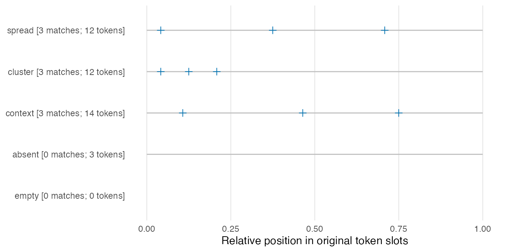
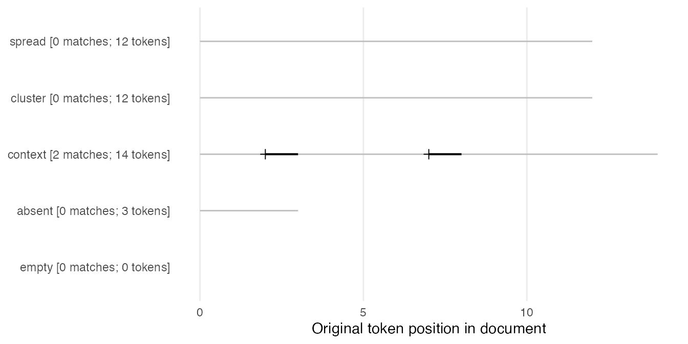

# Search words and phrases, then inspect their distribution

Three occurrences can be spread through a document or concentrated near
its beginning. A frequency table alone does not show that difference.
This guide first finds words or phrases in their original contexts, then
uses the same saved occurrences for context sorting, position plots and
a within-document dispersion measure. It keeps the search unit, excluded
positions and denominators visible so that a changed search can be
explained.

Use ldfreq 0.3.0.9009 or later and optional **quanteda \>= 4.5.0**;
plotting also needs **ggplot2**. Install these packages before running
the guide. The four helpers live in `examples/concordance.R` and are
explicitly sourced, installed example code. They are not exported
package functions. The example inputs and lemmas are authored for hand
checking; they are not learner observations or an evaluation of an
annotation system.

## Prepare complete annotations

``` r
library(ldfreq)

demo <- new.env(parent = globalenv())
sys.source(system.file("examples", "concordance-demo.R",
  package = "ldfreq", mustWork = TRUE), demo)
helper <- demo$helper
annotations <- demo$annotations
print(annotations$segments[c("document_id", "segment_id", "text")], row.names = FALSE)
#>  document_id segment_id                                        text
#>       spread         s1         learn a b c learn d e f learn g h i
#>      cluster         s1         learn learn learn a b c d e f g h i
#>      context         s1 We learn new words. They learned new words.
#>      context         s2                        learn very new words
#>       absent         s1                                 read a book
#>        empty         s1
```

`spread` and `cluster` each contain 12 original tokens and three
instances of `learn`, at positions 1/5/9 and 1/2/3 respectively.
`context` has two segments and includes `learned`; `absent` has no
matching word and `empty` has no tokens.

For your own data, supply an unchanged
[`lexdiv_import_annotations()`](https://ryuya-dot-com.github.io/ldfreq/reference/lexdiv_import_annotations.md)
result:

| Input | Required information |
|----|----|
| `tokens` | One row per original token: `document_id`, `segment_id`, consecutive `token_index`, original `surface`; optional character fields such as `lemma` |
| `segments` | Document and segment IDs plus original `text`, in the intended document order; include an empty segment for an empty document |
| `provenance` | Language, analyzer/version, dictionary/version, unit and normalization declarations |

The importer checks complete surface alignment and supplies
segment-local character spans. Import **before** excluding punctuation
or other tokens. Only whitespace may fall between supplied surfaces. The
search rejects modified import results: edit the original input and
import it again. A filtered lexical token vector is not a complete
annotation table. See [external
annotations](https://ryuya-dot-com.github.io/ldfreq/articles/japanese-annotations.md)
for analyzer recipes and [annotated
corpora](https://ryuya-dot-com.github.io/ldfreq/articles/annotated-corpora.md)
for the existing corpus adapters. No analyzer or dictionary is
downloaded by this guide.

To explain a lexical-diversity result, follow the [condition-comparison
example](https://ryuya-dot-com.github.io/ldfreq/articles/from-text-to-report.html#counted-source-occurrences).
It uses the same complete annotations and selection masks for counted
words and concordance searches, then retains them in the saved study
record.

For a short English text without supplied annotations, the following
explicit quanteda tokenization recipe can prepare complete surfaces. The
alignment check will reject text that this tokenizer changes or leaves
partly uncovered; inspect the tokens and adjust the chosen annotation
route, rather than dropping the check. Declare sentence/turn segments
first if matches must respect them.

``` r
raw_segments <- data.frame(document_id = c("my_text", "empty"),
  segment_id = "s1", text = c("We learn new words. We learned them.", ""))
raw_tokens <- as.list(quanteda::tokens(raw_segments$text, what = "word",
  remove_punct = FALSE, remove_symbols = FALSE, remove_numbers = FALSE,
  remove_url = FALSE, remove_separators = TRUE, split_hyphens = FALSE))
raw_rows <- do.call(rbind, lapply(seq_along(raw_tokens), function(i) data.frame(
  document_id = rep(raw_segments$document_id[i], length(raw_tokens[[i]])),
  segment_id = rep(raw_segments$segment_id[i], length(raw_tokens[[i]])),
  token_index = seq_along(raw_tokens[[i]]), surface = raw_tokens[[i]])))
raw_annotations <- lexdiv_import_annotations(raw_rows, raw_segments,
  list(language = "en", analyzer = "quanteda-tokens-word",
    analyzer_version = as.character(utils::packageVersion("quanteda")),
    dictionary = "none", dictionary_version = "not-applicable",
    unit = "word-tokenizer-with-punctuation", normalization = "none",
    settings = paste("remove_punct=FALSE; remove_symbols=FALSE; remove_numbers=FALSE;",
      "remove_url=FALSE; remove_separators=TRUE; split_hyphens=FALSE")))
raw_search <- helper$concordance_search(raw_annotations,
  list(learning = "^learn(ed)?$"), valuetype = "regex")
raw_search$counts
#>   document_id query_id occurrences
#> 1     my_text learning           2
#> 2       empty learning           0
```

This recipe preserves punctuation as original positions and adds no
lemmas. It treats each row as one searchable segment, so it does not
impose sentence boundaries within that row. Save the original texts and
tokenizer settings.

## Choose a search unit and pattern

``` r
keep <- !annotations$tokens$surface %in% c(".", "very")
search <- helper$concordance_search(annotations,
  queries = list(word = "learn", phrase = c("learn", "new"), absent = "unlisted"),
  term_col = "lemma", valuetype = "fixed", case_insensitive = FALSE,
  keep = keep, window = 2L)
print(search$counts, row.names = FALSE)
#>  document_id query_id occurrences
#>       spread     word           3
#>      cluster     word           3
#>      context     word           3
#>       absent     word           0
#>        empty     word           0
#>       spread   phrase           0
#>      cluster   phrase           0
#>      context   phrase           2
#>       absent   phrase           0
#>        empty   phrase           0
#>       spread   absent           0
#>      cluster   absent           0
#>      context   absent           0
#>       absent   absent           0
#>        empty   absent           0
print(search$occurrences[c("query_id", "document_id", "segment_id",
  "pre", "keyword", "post")], row.names = FALSE)
#>  query_id document_id segment_id          pre     keyword         post
#>      word      spread         s1                    learn          a b
#>      word      spread         s1         b c        learn          d e
#>      word      spread         s1         e f        learn          g h
#>      word     cluster         s1                    learn  learn learn
#>      word     cluster         s1       learn        learn      learn a
#>      word     cluster         s1 learn learn        learn          a b
#>      word     context         s1          We        learn    new words
#>      word     context         s1      . They      learned    new words
#>      word     context         s2                    learn     very new
#>    phrase     context         s1          We    learn new       words.
#>    phrase     context         s1      . They  learned new       words.
```

Each named list element is one query ID. A character vector within it
specifies consecutive token patterns: `c("learn", "new")` searches two
tokens, while `"learn new"` is one literal token pattern and is not
split automatically. `term_col` selects the supplied surface, lemma or
another character annotation. The displayed keyword and context always
come from the original surface text. Thus the lemma query `learn` finds
both `learn` and `learned` here.

Matching follows [quanteda’s pattern
rules](https://quanteda.io/reference/pattern.html) and [value
types](https://quanteda.io/reference/valuetype.html):

| `valuetype` | Example | Meaning |
|----|----|----|
| `"fixed"` | `"learn"` | Literal token matching with the declared case policy |
| `"glob"` | `"learn*"` | `*` matches zero or more characters; `?` matches one |
| `"regex"` | `"^learn(ed)?$"` | A regular expression applied to each token; anchors restrict it to a whole token |

``` r
wildcard <- helper$concordance_search(annotations,
  list(forms = "learn*", phrase = c("learn*", "new")), valuetype = "glob", keep = keep)
regular <- helper$concordance_search(annotations,
  list(forms = "^learn(ed)?$"), valuetype = "regex", keep = keep)
print(wildcard$counts, row.names = FALSE)
#>  document_id query_id occurrences
#>       spread    forms           3
#>      cluster    forms           3
#>      context    forms           3
#>       absent    forms           0
#>        empty    forms           0
#>       spread   phrase           0
#>      cluster   phrase           0
#>      context   phrase           2
#>       absent   phrase           0
#>        empty   phrase           0
stopifnot(sum(regular$counts$occurrences) == 9L)
```

Regex is applied to tokens, **not to the raw text**. An unanchored
`learn` regex also matches `unlearn`. Fixed matching is not a
byte-identity check: quanteda may match canonically equivalent Unicode
spellings. Original surface strings and character spans remain
unchanged, and quanteda/stringi/ICU versions are saved. The existing
[exact phrase-review
recipe](https://ryuya-dot-com.github.io/ldfreq/articles/ambiguity-review.md)
uses its own stricter surface comparison; its decisions and counts are
unchanged.

Every contiguous match is retained, including overlapping phrases and
identical patterns under different query IDs. Do not sum different query
counts as a unique-token coverage measure. Matches and context stop at
supplied segment boundaries; sentence boundaries apply only when
represented as segments. Excluded tokens and missing/blank search terms
leave gaps and cannot complete a phrase, including a wildcard phrase.
The example therefore does not turn `learn very new` into `learn new`
after excluding `very`.

``` r
print(search$documents, row.names = FALSE)
#>  document_id source_tokens kept_tokens searchable_tokens missing_terms
#>       spread            12          12                12             0
#>      cluster            12          12                12             0
#>      context            14          11                11             0
#>       absent             3           3                 3             0
#>        empty             0           0                 0             0
```

`source_tokens` counts all original positions. `kept_tokens` applies
`keep`; `searchable_tokens` also requires a nonblank search term.
`missing_terms` counts kept positions with no usable term. None of these
choices renumbers positions. The context window counts original
positions, so excluded punctuation can still appear as context. The
default `max_cells = 1e6` limits original token slots, document-query
count cells and the match/context allocation separately; it is not a
memory-size guarantee. Reduce the saved window or split intended
searches before raising it for a larger input.

## Sort by the nearest context words

``` r
right_sorted <- helper$concordance_sort(search, side = "right", depth = 2L)
left_sorted <- helper$concordance_sort(search, side = "left", depth = 2L)
print(right_sorted[c("query_id", "document_id", "pre", "keyword", "post")], row.names = FALSE)
#>  query_id document_id          pre     keyword         post
#>      word      spread                    learn          a b
#>      word     cluster learn learn        learn          a b
#>      word      spread         b c        learn          d e
#>      word      spread         e f        learn          g h
#>      word     cluster       learn        learn      learn a
#>      word     cluster                    learn  learn learn
#>      word     context          We        learn    new words
#>      word     context      . They      learned    new words
#>      word     context                    learn     very new
#>    phrase     context          We    learn new       words.
#>    phrase     context      . They  learned new       words.
```

The saved `left_tokens` and `right_tokens` list columns start with the
nearest surface token. Left sorting uses L1, then L2; right sorting uses
R1, then R2. It does not alphabetize the complete displayed `pre`
string. Ties retain query order, supplied segment order and original
match position. Absent context sorts last at each depth. Sorting uses
UTF-8 radix order, independent of locale, rather than language-specific
collation. `ignore_case = TRUE` case-folds only the sort keys. Request a
depth no larger than the saved `window`.

`from`/`to` are segment token positions. `document_from`/`document_to`
concatenate original segment slots in supplied order, without inventing
separator tokens. `start`/`end` are 1-based, inclusive Unicode-codepoint
positions **within the original segment**, not byte offsets or positions
in a newly joined text. `occurrence_id` identifies a match within the
saved search condition. Changing queries, settings or source creates a
different search identity; sorting does not.

## Plot those same occurrences

``` r
positions <- helper$concordance_positions(search, "word")
positions
```



Each plus marks the original start position. A horizontal stroke also
shows the matched span for a multi-token query. Document labels retain
match and original token counts, including zero-match and empty
documents. An empty document has no occurrence or text-length line. This
is an occurrence plot, not a density estimate or a dispersion statistic.

For page- or Unit-based counts and recurrence after a teaching
introduction, see [textbook
progression](https://ryuya-dot-com.github.io/ldfreq/articles/textbook-progression.md),
available in development 0.4.0.9003 or later. It joins these saved
occurrences to a separate ordered section roster; the token-position and
DP definitions here remain unchanged.

Relative coordinates are `(position - 0.5) / source_tokens`, the centers
of the original token slots on a common 0–1 scale. Exclusions do not
shorten the axis. Use `relative = FALSE` for a shared absolute
token-position axis:

``` r
helper$concordance_positions(search, "phrase", relative = FALSE, monochrome = TRUE)
```



``` r
stopifnot(identical(positions$data$occurrence_id,
  search$occurrences$occurrence_id[search$occurrences$query_id == "word"]))
```

The plot reads the saved table without retokenization or a new search.
Its `data` retains occurrence IDs and coordinates for inspection. Colour
is the default; `monochrome = TRUE` keeps the same marks and axes. Add
figure numbering, titles and explanatory notes in the surrounding
manuscript.

## Calculate within-document DP

This recipe implements the unnormalized DP definition in [Gries (2008,
Section
3)](https://www.stgries.info/research/2008_STG_Dispersion_IJCL.pdf):

``` math
DP = \frac{1}{2}\sum_{j=1}^{K}|o_j-s_j|,
\qquad o_j=f_j/\sum_j f_j,\quad s_j=n_j/\sum_j n_j.
```

Here `parts = K` divides each document’s **original token slots** into
fixed intervals, with part index `floor((position - 1) * K / N) + 1` for
original length `N`. Within each part, `f_j` counts saved matches and
`n_j` counts searchable tokens. Exclusions and missing terms can make
these exposure counts unequal. The result retains original interval
bounds, both counts and both shares. A larger value indicates greater
departure from the declared exposure distribution; it does not
necessarily mean a geometrically narrower cluster.

``` r
dispersion <- helper$concordance_dispersion(search, "word", parts = 3L)
print(dispersion$documents[c("document_id", "searchable_tokens", "occurrences",
  "DP", "status", "missing_reason")], digits = 4, row.names = FALSE)
#>  document_id searchable_tokens occurrences      DP  status       missing_reason
#>       spread                12           3 0.00000      ok                 <NA>
#>      cluster                12           3 0.66667      ok                 <NA>
#>      context                11           3 0.06061      ok                 <NA>
#>       absent                 3           0      NA missing           no_matches
#>        empty                 0           0      NA missing no_searchable_tokens
print(subset(dispersion$parts, document_id %in% c("spread", "cluster"))[
  c("document_id", "part", "searchable_tokens", "occurrences", "expected_share", "observed_share")],
  digits = 3, row.names = FALSE)
#>  document_id part searchable_tokens occurrences expected_share observed_share
#>       spread    1                 4           1          0.333          0.333
#>       spread    2                 4           1          0.333          0.333
#>       spread    3                 4           1          0.333          0.333
#>      cluster    1                 4           3          0.333          1.000
#>      cluster    2                 4           0          0.333          0.000
#>      cluster    3                 4           0          0.333          0.000
stopifnot(isTRUE(all.equal(dispersion$documents$DP[1:2], c(0, 2/3))))
```

For `spread`, all three parts contain four searchable tokens and one
match: both shares are `(1/3, 1/3, 1/3)`, so DP is 0. For `cluster`, the
match shares are `(1, 0, 0)` with the same exposure shares, so DP is
`(|1 - 1/3| + |0 - 1/3| + |0 - 1/3|) / 2 = 2/3`.

This is **within-document**, single-token-query DP, including a
regex/glob that selects a class of individual tokens. It does not
compare the distribution across documents. Multi-token queries are
rejected for DP because they require a separately defined
phrase-opportunity denominator; their position plots remain available.
No small-sample, maximum-value or frequency correction is applied. Total
concentration in a part with exposure share `s` gives `1 - s`, not
necessarily 1. DP depends on frequency and partition choice; it is
neither a significance test nor a proficiency measure.

No searchable tokens or no matches yield `NA` with a distinct
`missing_reason`. The recipe also requires at least two parts with
positive searchable exposure; otherwise it returns
`fewer_than_two_nonempty_parts`. A single match is computable when that
requirement is met, but its value largely reflects which part contains
it. These missing-value rules and the partition are explicit choices of
this recipe. Report frequency, counts, boundaries and exclusions beside
DP; do not compare different query or partition policies silently.

## Save and reopen the complete analysis

For research, replace `saved` below with a lasting private path such as
`"concordance-record.rds"`. Paths are relative to
[`getwd()`](https://rdrr.io/r/base/getwd.html) unless absolute;
temporary files can disappear when R closes. Keep the original session
record.

``` r
record <- list(search = search, sorted = right_sorted, dispersion = dispersion,
  sort = list(side = "right", depth = 2L, ignore_case = FALSE),
  session = utils::sessionInfo())
saved <- tempfile(fileext = ".rds") # Choose a persistent filename for research data.
saveRDS(record, saved)
restored <- readRDS(saved)
stopifnot(identical(restored, record),
  identical(helper$concordance_sort(restored$search, "right", 2L), restored$sorted),
  identical(helper$concordance_dispersion(restored$search, "word", 3L), restored$dispersion),
  identical(restored$dispersion$occurrence_ids,
    restored$search$occurrences$occurrence_id[restored$search$occurrences$query_id == "word"]))
```

In a fresh R session, use the same package snapshot and your saved path:

``` r
library(ldfreq)
helper <- new.env(parent = globalenv())
sys.source(system.file("examples", "concordance.R", package = "ldfreq",
  mustWork = TRUE), helper)
restored <- readRDS("concordance-record.rds")
sorted <- do.call(helper$concordance_sort,
  c(list(x = restored$search), restored$sort))
stopifnot(identical(sorted, restored$sorted))
sorted
```

This sorts the saved matches without a new search. The saved search
includes complete source annotations, queries, selection masks,
versions, counts and occurrence IDs. Integrity checks reject edited
saved results; rerun the search from newly imported source when changing
an input. These hashes check accidental changes, not authorship. A
flattened CSV cannot retain the source object, settings and
context-vector columns; use it only as a display or exchange table
beside the complete RDS.

To connect documents to writers, tasks and occasions, join their
retained `document_id` to your explicit metadata map; see [the
repeated-observation
guide](https://ryuya-dot-com.github.io/ldfreq/articles/repeated-observations.md).
KWIC rows and overlapping matches are not independent participants. This
guide checks search and calculation behavior; it does not establish an
inferential model or validate a language-learning outcome.

Gries, S. Th. (2008). Dispersions and adjusted frequencies in corpora.
*International Journal of Corpus Linguistics, 13*(4), 403–437.
<https://doi.org/10.1075/ijcl.13.4.02gri>
