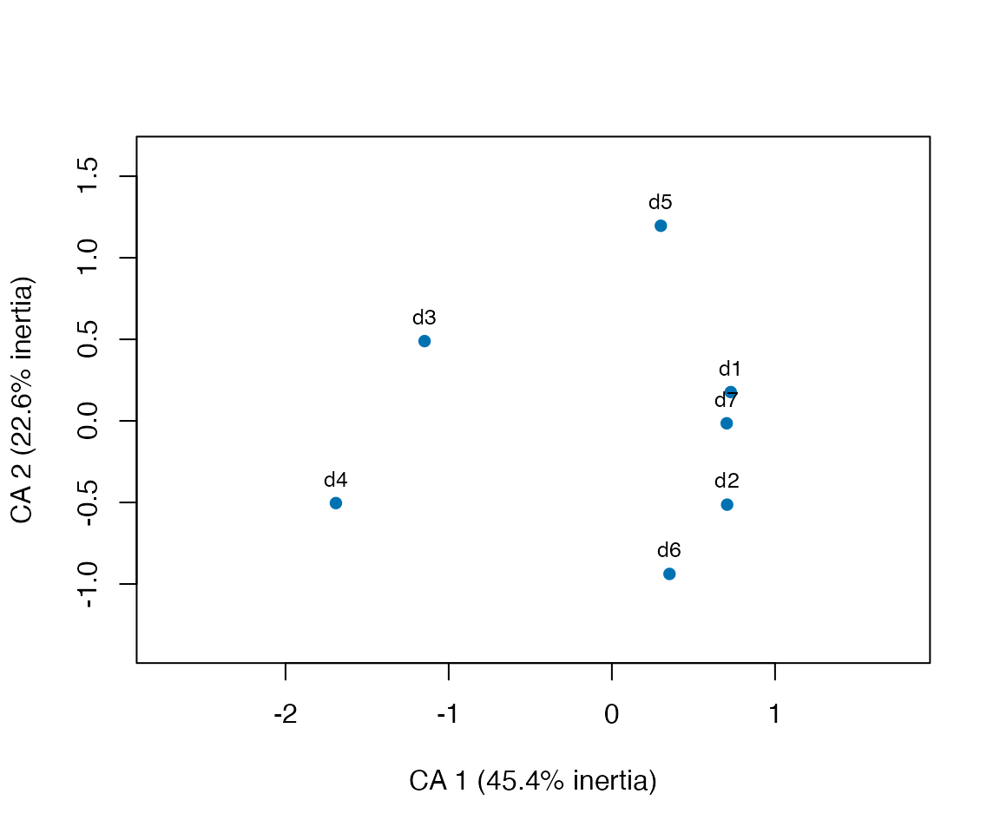
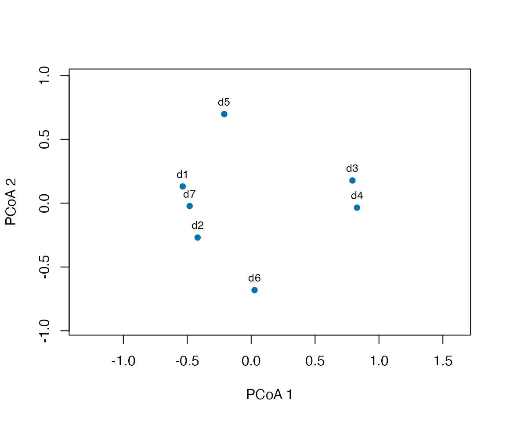
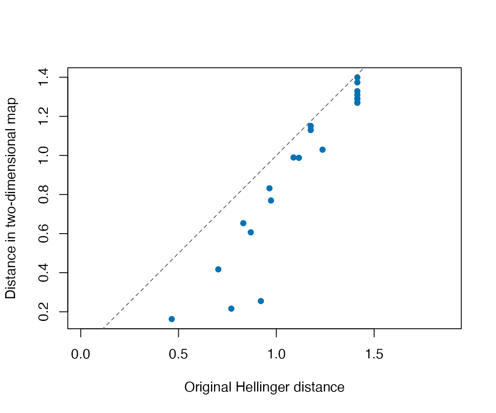

# Explore lexical composition with CA and MDS

Which documents use similar vocabulary, and which words help explain
their differences? Correspondence analysis (CA) describes a
document-by-term count table. Classical multidimensional scaling (MDS,
also called principal coordinates analysis or PCoA) represents a chosen
set of document dissimilarities. The choice of dissimilarity defines
what “similar” means; a map does not establish semantic similarity,
proficiency, a causal effect, or a statistically significant group.

This guide uses **ldfreq 0.3.0.9018 or later**. Its helpers are
explicitly sourced installed examples, not exported functions. MDS uses
R’s [`stats::cmdscale()`](https://rdrr.io/r/stats/cmdscale.html); CA
requires the optional `ca` package (`install.packages("ca")`). No new
tokenizer or model is needed. The example uses authored counts to make
the calculations checkable, not empirical learner differences.

## Begin with the counted documents

``` r
library(ldfreq)
demo <- new.env(parent = globalenv())
sys.source(system.file("examples", "lexical-ordination-demo.R",
  package = "ldfreq", mustWork = TRUE), demo)
helper <- demo$helper
tab <- demo$tab
print(tab$documents, row.names = FALSE)
#>  document_id requested source_tokens kept_tokens missing_terms counted_tokens
#>           d1      TRUE             8           7             0              7
#>           d2      TRUE             6           6             0              6
#>           d3      TRUE             7           7             0              7
#>           d4      TRUE             6           6             0              6
#>           d5      TRUE             6           6             0              6
#>           d6      TRUE             6           6             0              6
#>           d7      TRUE             7           7             0              7
#>      partial      TRUE             2           2             1              1
#>        empty      TRUE             0           0             0              0
#>      removed      TRUE             1           0             0              0
#>      outside     FALSE             1           1             0              0
#>              status active_tokens
#>              active             7
#>              active             6
#>              active             7
#>              active             6
#>              active             6
#>              active             6
#>              active             7
#>    incomplete_terms             0
#>        empty_source             0
#>  no_selected_tokens             0
#>       not_requested             0
tab$active_counts
#>    learn read write speak tree river rain wind
#> d1     4    2     1     0    0     0    0    0
#> d2     3    1     0     2    0     0    0    0
#> d3     0    0     0     0    4     2    1    0
#> d4     0    0     0     0    2     0    3    1
#> d5     2    0     2     0    0     2    0    0
#> d6     0    3     0     2    1     0    0    0
#> d7     1    4     2     0    0     0    0    0
```

Seven documents contribute 45 tokens. `partial` has an unavailable
selected lemma, so its entire profile is excluded. `empty` has no source
tokens, `removed` has no selected tokens, and `outside` was not
requested. These states remain separate. `counts` retains available
counts for all requested documents; `active_counts` contains exactly the
complete, nonempty profiles fitted below. The former must not be
silently substituted for the latter.

The source, original token rows and selection mask are retained. The
recipe does not normalize case or Unicode, infer lemmas, combine
documents, or treat missing labels as absence. Word identity is the
exact selected string.

For your own **unchanged**
[`lexdiv_import_annotations()`](https://ryuya-dot-com.github.io/ldfreq/reference/lexdiv_import_annotations.md)
result, load the helpers explicitly and supply IDs and a selection rule.
The [annotation
guide](https://ryuya-dot-com.github.io/ldfreq/articles/annotated-corpora.md)
describes source-aligned inputs.

``` r
helper <- new.env(parent = globalenv())
for (file in c("concordance.R", "lexical-ordination.R"))
  sys.source(system.file("examples", file, package = "ldfreq", mustWork = TRUE), helper)
tab <- helper$ordination_table(
  annotations, document_ids = study_document_ids,
  preprocessing_id = "lemma-exclude-punctuation-v1",
  term_col = "lemma", keep = keep,
  min_count = 1L, min_documents = 1L
)
```

`keep` has one nonmissing logical value per original token. The
preprocessing label describes a policy; it does not prove that different
annotation pipelines are equivalent. The minimum count and
document-frequency thresholds use the requested documents with complete
selected terms and are applied once, before fitting. `features` retains
counts and selection decisions. A document with no retained features
remains in the audit as `no_selected_features`.

Thresholds change the analyzed vocabulary and hence the geometry. Choose
them for the research question and report them; do not tune them to make
groups separate. The default retains every term in the complete selected
profiles. The example bounds dense document-term and document-distance
matrices using `max_cells = 1e6`; it is intended for a bounded research
collection.

## CA: inspect the words that define the configuration

``` r
has_ca <- requireNamespace("ca", quietly = TRUE)
if (has_ca) {
  ca_result <- helper$ordination_ca(tab, k = 2)
  print(ca_result$axes)
  print(ca_result$diagnostics)
  first_axis <- subset(ca_result$columns, axis == 1)
  print(first_axis[order(first_axis$contribution, decreasing = TRUE), ], row.names = FALSE)
}
#>   axis   eigenvalue inertia_fraction
#> 1    1 0.8410747205     0.4536757505
#> 2    2 0.4193407701     0.2261924345
#> 3    3 0.2895034125     0.1561581566
#> 4    4 0.2252001062     0.1214729497
#> 5    5 0.0779002735     0.0420194118
#> 6    6 0.0008922818     0.0004812968
#> $total_inertia
#> [1] 1.853912
#> 
#> $requested_dimensions
#> [1] 2
#> 
#> $effective_dimensions
#> [1] 2
#> 
#> $eigenvalue_tolerance
#> [1] 8.410747e-11
#> 
#>     id axis coordinate       mass contribution       cos2
#>   rain    1 -1.6959986 0.08888889   0.30399319 0.79447114
#>   tree    1 -1.1870903 0.15555556   0.26062645 0.75582475
#>  learn    1  0.6909648 0.22222222   0.12614347 0.44709388
#>   read    1  0.6583431 0.22222222   0.11451372 0.41847030
#>   wind    1 -1.8441299 0.02222222   0.08985369 0.52320232
#>  write    1  0.5966622 0.11111111   0.04703054 0.23961929
#>  speak    1  0.5775868 0.08888889   0.03525717 0.12131146
#>  river    1 -0.4622453 0.08888889   0.02258177 0.08608317
```

CA compares row profiles using column marginal frequencies and weights
documents by their token totals. Longer documents therefore have greater
mass; it does not make all documents equally influential. The `rows` and
`columns` tables report principal coordinates, mass, contribution (a
proportion, not a percentage) and cos². Contribution describes a point’s
role in an axis. Cos² describes how well that axis represents the point;
it is `NA` for points with numerically zero distance to the centroid. A
distant rare word need not contribute much.

``` r
if (has_ca) helper$ordination_plot(ca_result)
```



``` r
if (has_ca) helper$ordination_plot(ca_result, which = "terms", monochrome = TRUE)
```


Document and term maps are separate principal-coordinate maps. Do not
compare their plotted row-to-column distances as if they measured
association. In these authored documents, the school-related and
nature-related words help explain the dominant contrast; this is a
vocabulary-composition description, not a validated topic or ability
scale. Read the contributions and cos² before naming an axis. CA has at
most `min(documents - 1, terms - 1)` nontrivial dimensions; rank-one
inputs receive a one-dimensional display. Identical profiles have no
nonzero CA inertia and are reported as not analyzable.

## MDS: choose the meaning of dissimilarity

Jaccard dissimilarity is `1 - shared types / union types`. Hellinger
distance here is the Euclidean distance between square-root
relative-frequency profiles, without the optional `1/sqrt(2)` scaling.
Jaccard ignores repetition. Hellinger retains differences in allocation
among words. Neither removes the sampling uncertainty of short
documents; Jaccard also depends on the observed type sets.

``` r
jaccard <- helper$ordination_mds(tab, distance = "jaccard", k = 2)
hellinger <- helper$ordination_mds(tab, distance = "hellinger", k = 2)
as.matrix(jaccard$distance)["d1", "d7"]
#> [1] 0
as.matrix(hellinger$distance)["d1", "d7"]
#> [1] 0.4651756
```

`d1` and `d7` use exactly the same types, so their Jaccard distance is
zero. Their allocation of tokens differs, so their Hellinger distance is
positive. These results answer different questions; they do not show
that one distance is universally better. The original distance object
retains document labels. Directional coverage is not a symmetric
distance and is not accepted here.

``` r
helper$ordination_plot(hellinger)
```



MDS axes are coordinates, not automatically interpretable lexical
traits. Their sign or orientation can change while all interpoint
distances remain identical. The plotting helper uses equal axis units
and returns the plotted data invisibly. Use `monochrome = TRUE` for
black and white. Group labels, if added, must be matched by document ID
and do not test a group effect. Repeated observations retain their
writer/task/occasion information separately; MDS does not model their
dependence. Independently fitted maps cannot be compared by raw
coordinates.

## Check what a two-dimensional map loses

``` r
jaccard$diagnostics
#> $requested_dimensions
#> [1] 2
#> 
#> $effective_dimensions
#> [1] 2
#> 
#> $negative_eigenvalues
#> [1] 1
#> 
#> $negative_inertia_fraction
#> [1] 0.001846276
#> 
#> $eigenvalue_tolerance
#> [1] 1.095259e-10
#> 
#> $distance_rmse
#> [1] 0.08992803
#> 
#> $relative_distance_error
#> [1] 0.1128306
#> 
#> $GOF
#> [1] 0.8834979 0.8851321
#> 
#> $engine_warnings
#> character(0)
hellinger$diagnostics
#> $requested_dimensions
#> [1] 2
#> 
#> $effective_dimensions
#> [1] 2
#> 
#> $negative_eigenvalues
#> [1] 0
#> 
#> $negative_inertia_fraction
#> [1] 0
#> 
#> $eigenvalue_tolerance
#> [1] 2.053396e-10
#> 
#> $distance_rmse
#> [1] 0.2436704
#> 
#> $relative_distance_error
#> [1] 0.2102844
#> 
#> $GOF
#> [1] 0.776418 0.776418
#> 
#> $engine_warnings
#> character(0)
head(hellinger$pairs)
#>   document_a document_b original_distance fitted_distance
#> 1         d1         d2         0.7032206       0.4171164
#> 2         d1         d3         1.4142136       1.3287895
#> 3         d1         d4         1.4142136       1.3740066
#> 4         d1         d5         0.8310792       0.6533169
#> 5         d1         d6         1.1153793       0.9877046
#> 6         d1         d7         0.4651756       0.1626916
```

`distance_rmse` is the root mean squared difference between the original
and plotted distances. `relative_distance_error` divides their sum of
squared errors by the sum of squared original distances before taking
the square root; it is not NMDS stress. The example’s Jaccard matrix has
a negative eigenvalue. Its negative magnitude relative to total absolute
eigenvalue magnitude is retained, with a relative eigenvalue tolerance
of `1e-10`. No additive correction or silent distance transformation is
applied. Non-Euclidean geometry and omission of positive dimensions can
both prevent distance reconstruction. There is no automatic
acceptability threshold for the resulting map.

``` r
with(hellinger$pairs, {
  plot(original_distance, fitted_distance, asp = 1, pch = 16, col = "#0072B2",
    xlab = "Original Hellinger distance", ylab = "Distance in two-dimensional map")
  abline(0, 1, lty = 2, col = "grey40")
})
```



This plot overlays the identity line on the original and reproduced
distances. Inspect pairs far from that line before interpreting local
neighborhoods. All-zero distances have no nontrivial configuration. Zero
distances between some nonempty documents are retained, not replaced by
arbitrary small positive values. The recipe exposes the requested and
effective dimension counts and any recorded rank warning from
[`cmdscale()`](https://rdrr.io/r/stats/cmdscale.html).

## Return to the evidence and save the complete analysis

``` r
helper$ordination_occurrences(tab, "learn")
#>    document_id segment_id token_index start end token_row  term
#> 1           d1         s1           1     1   5         1 learn
#> 2           d1         s1           2     7  11         2 learn
#> 3           d1         s1           3    13  17         3 learn
#> 4           d1         s1           4    19  23         4 learn
#> 8           d2         s1           1     1   5         9 learn
#> 9           d2         s1           2     7  11        10 learn
#> 10          d2         s1           3    13  17        11 learn
#> 27          d5         s1           1     1   5        28 learn
#> 28          d5         s1           2     7  11        29 learn
#> 39          d7         s1           1     1   5        40 learn
#>                                         text surface
#> 1  learn learn learn learn read read write .   learn
#> 2  learn learn learn learn read read write .   learn
#> 3  learn learn learn learn read read write .   learn
#> 4  learn learn learn learn read read write .   learn
#> 8         learn learn learn read speak speak   learn
#> 9         learn learn learn read speak speak   learn
#> 10        learn learn learn read speak speak   learn
#> 27       learn learn river river write write   learn
#> 28       learn learn river river write write   learn
#> 39     learn read read read read write write   learn
pair <- lexdiv_term_overlap(
  colnames(tab$active_counts)[tab$active_counts["d1", ] > 0],
  colnames(tab$active_counts)[tab$active_counts["d3", ] > 0],
  document_ids = c("d1", "d3"), measures = "jaccard_types", details = "terms"
)
pair$shared_terms
#> [1] term          token_count_a token_count_b
#> <0 rows> (or 0-length row.names)
pair$unique_to_a
#>    term token_count_a
#> 1 learn             1
#> 2  read             1
#> 3 write             1
pair$unique_to_b
#>    term token_count_b
#> 1  rain             1
#> 2 river             1
#> 3  tree             1
```

Occurrence rows retain document, segment, token and character offsets
plus the original text. Optional context searches can use the existing
[concordance
workflow](https://ryuya-dot-com.github.io/ldfreq/articles/concordance-and-dispersion.md),
with the saved active token mask. The pair comparison above verifies the
type-based interpretation; it does not reproduce Hellinger distance
because that distance uses frequencies.

For research, replace `path` below with a lasting private path such as
`"ordination-record.rds"`. Relative paths start at
[`getwd()`](https://rdrr.io/r/base/getwd.html); temporary files can
disappear when R closes.

``` r
record <- list(table = tab, ca = if (has_ca) ca_result else NULL,
  jaccard = jaccard, hellinger = hellinger, session = sessionInfo())
path <- tempfile(fileext = ".rds") # Choose a persistent private path for your study.
saveRDS(record, path, version = 2)
reopened <- readRDS(path)
helper$ordination_validate(reopened$table)
helper$ordination_validate(reopened$jaccard)
stopifnot(identical(reopened, record))
```

In another R session, use the same package snapshot and your saved path:

``` r
library(ldfreq)
helper <- new.env(parent = globalenv())
for (script in c("concordance.R", "lexical-ordination.R"))
  sys.source(system.file("examples", script, package = "ldfreq", mustWork = TRUE), helper)
reopened <- readRDS("ordination-record.rds")
helper$ordination_validate(reopened$table)
helper$ordination_validate(reopened$hellinger)
helper$ordination_occurrences(reopened$table, "learn") # Choose a term in your saved table.
helper$ordination_plot(reopened$hellinger)
```

This inspects saved counts and coordinates without fitting CA or MDS
again. Keep the recorded calculation session unchanged; a new
[`sessionInfo()`](https://rdrr.io/r/utils/sessionInfo.html) describes
the current reporting session. The saved table contains source texts;
keep it under the same access restrictions as those texts. A CSV of
coordinates is useful for display but does not replace this record.

A report should state the observational unit and included IDs,
token/lemma and selection policy, excluded-document counts and reasons,
feature thresholds, distance or CA weighting, dimensions, diagnostics
and software versions. For example: “We retained seven complete nonempty
profiles (45 tokens), excluding one document with a missing selected
lemma, one empty source and one document without selected tokens. We
described lexical composition by CA and examined type sharing and
frequency composition with separately defined MDS distances.” Add the
actual inertia and distance-reconstruction diagnostics from the saved
results and describe their implications. Do not turn this authored
example into an empirical claim about learner development.

MCA, nonmetric MDS, automatic feature/distance selection and inferential
tests are outside this recipe. CA and weighted PCoA with chi-square
distances can describe the same geometry; agreement between such maps is
not independent validation.

## References

- Nenadic, O., & Greenacre, M. (2007). [Correspondence analysis in R,
  with two- and three-dimensional graphics: The ca
  package](https://doi.org/10.18637/jss.v020.i03). *Journal of
  Statistical Software, 20*(3), 1–13.
- R Core Team. [Classical multidimensional scaling:
  cmdscale](https://stat.ethz.ch/R-manual/R-devel/library/stats/html/cmdscale.html).
- Legendre, P., & Gallagher, E. D. (2001). Ecologically meaningful
  transformations for ordination of species data. *Oecologia, 129*,
  271–280. [Transformation
  definitions](https://vegandevs.github.io/vegan/reference/decostand.html).
