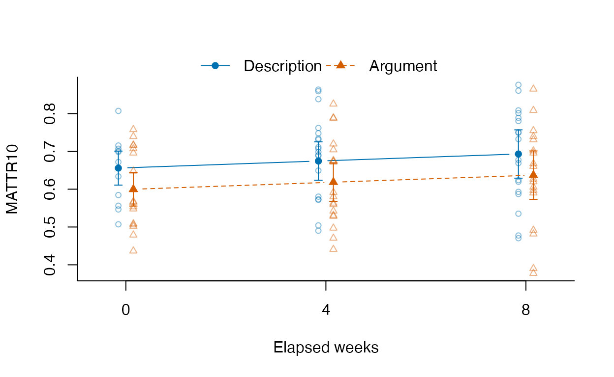

# From planned observations to a mixed model

A writer may complete several tasks on several occasions. Some scheduled
texts may never arrive; others may be empty or too short for a requested
measure. Keeping only successful scores loses the difference between
these situations. Stacking several measures or overlapping windows as if
they were independent texts creates a different problem: the number of
measurement rows is not the number of observations.

This guide keeps the scheduled observations, submitted documents and
calculated results as separate inputs. It then constructs a complete
table and selects one declared specification for a conventional mixed
model. The question in the example is whether a chosen lexical-diversity
response varies with elapsed weeks and two named tasks, allowing writers
to have different starting values and linear time slopes. The inputs are
**authored synthetic word sequences**, not learner texts. Fitting them
checks the connection between tables and a model; it supplies no
evidence of development, proficiency or causation.

The public functions
[`lexdiv_study_table()`](https://ryuya-dot-com.github.io/ldfreq/reference/lexdiv_study_table.md)
and
[`lexdiv_study_model_data()`](https://ryuya-dot-com.github.io/ldfreq/reference/lexdiv_study_table.md)
use saved results from `lexdiv_metrics_batch(..., plan = plan)` and do
not fit or choose a model. The table workflow needs no additional
package. Only the model section uses optional
[lme4](https://lme4.github.io/lme4/).

## Start with the planned observations

The example schedules 18 writers for two tasks at weeks 0, 4 and 8: 108
planned observations. Its first observation is deliberately not
submitted. Other authored cases include an empty string, punctuation
only, three words, a document withheld from reporting and an unknown
writer ID.

``` r
library(ldfreq)

demo <- new.env(parent = globalenv())
sys.source(system.file("examples", "repeated-study-demo.R",
  package = "ldfreq", mustWork = TRUE), demo)
record <- demo$record
print(head(record$planned, 6), row.names = FALSE)
#>  writer_id        task occasion observation_id scheduled_date
#>        001 description        0        obs-001     2026-01-05
#>        002 description        0        obs-002     2026-01-05
#>        003 description        0        obs-003     2026-01-05
#>        004 description        0        obs-004     2026-01-05
#>        005 description        0        obs-005     2026-01-05
#>       <NA> description        0        obs-006     2026-01-05
print(head(record$submissions, 5), row.names = FALSE)
#>  observation_id document_id input_characters
#>         obs-002     doc-002                0
#>         obs-003     doc-003                7
#>         obs-004     doc-004               16
#>         obs-005     doc-005              464
#>         obs-006     doc-006              456
```

Replace these two tables with your own scheduled rows and actual
document map:

| Input | One row means | Required columns |
|----|----|----|
| `planned` | One scheduled observation | Unique character `observation_id`, `writer_id`, `task`, `occasion` |
| `submissions` | One selected document for a scheduled observation | `observation_id`, unique character `document_id`, `input_characters` |
| `results` | One submitted document and plan request | Complete output of `lexdiv_metrics_batch(..., plan = plan)` |
| `reporting` | One decision for a submitted document and request | `document_id`, `request_id`, `reporting_status`, `reporting_reason` |

Do not infer the schedule by taking every writer-by-task-by-occasion
combination unless the design actually schedules them all. The example
uses that design explicitly. Each observation can have zero or one
selected document. If there are revisions or multiple attempts, declare
distinct observation/attempt IDs or supply a documented selection or
aggregation rule before constructing the map; the helper rejects
duplicate mappings and does not average texts.

`writer_id` and `task` are character or factor labels, with `NA` for
unknown values. IDs such as `"007"` remain strings. `occasion` retains
the supplied type: elapsed weeks here, possibly a factor or date in
another study. Additional atomic columns, such as the scheduled date,
are retained. For CSV input, declare ID column types when reading; a
leading zero already removed by import cannot be recovered. A submitted
empty text has `input_characters = 0`; use `NA` if the original
character count is unavailable. An unsubmitted observation has no row in
`submissions`.

## Keep the measurement and preprocessing identities

The example tokenizes saved English text with explicit NFC
normalization, lowercase spelling and number exclusion. It preserves the
full tokenization objects, original texts and the selected surface-token
vectors. The plan asks for TTR and MATTR with a fixed ten-token window:

``` r
plan <- lexdiv_plan(presets = character(), specs = list(
  lexdiv_spec("ttr_v_over_n_v1", request_id = "ttr"),
  lexdiv_spec("mattr_sliding_step1_v1", list(window_length = 10),
    request_id = "mattr10")
))
stopifnot(identical(plan, record$plan))
record$condition
#> $id
#> [1] "english-surface-lower"
#> 
#> $tokenizer
#> [1] "english"
#> 
#> $normalization
#> [1] "NFC"
#> 
#> $case
#> [1] "lower"
#> 
#> $keep_numbers
#> [1] FALSE
#> 
#> $unit
#> [1] "surface"
#> 
#> $inclusion
#> [1] "all tokens returned by lexdiv_tokenize_batch"
#> 
#> $resources
#> [1] "No external annotation model or lexical reference resource"
record$prepared[[1]]$provenance[c("tokenizer_id", "tokenizer_version",
  "normalization", "case", "keep_numbers", "input_characters", "output_tokens")]
#> $tokenizer_id
#> [1] "ldfreq-english-word-tokenizer"
#> 
#> $tokenizer_version
#> [1] "0.1.0"
#> 
#> $normalization
#> [1] "NFC"
#> 
#> $case
#> [1] "lower"
#> 
#> $keep_numbers
#> [1] FALSE
#> 
#> $input_characters
#> [1] 0
#> 
#> $output_tokens
#> [1] 0
```

In your own analysis, calculate the complete batch with
`lexdiv_metrics_batch(tokens, plan = plan)`. For raw text, prepare
`tokens` with
[`lexdiv_tokenize_batch()`](https://ryuya-dot-com.github.io/ldfreq/reference/lexdiv_text_batch.md)
first, as the installed example does.
[`lexdiv_metrics_text_batch()`](https://ryuya-dot-com.github.io/ldfreq/reference/lexdiv_text_batch.md)
does not accept `plan` in this workflow. For imported annotations,
explicitly select the unit and inclusion policy and retain the original
annotation/model/dictionary records beside the selected tokens; see
[Japanese
annotations](https://ryuya-dot-com.github.io/ldfreq/articles/japanese-annotations.md)
and [annotated
corpora](https://ryuya-dot-com.github.io/ldfreq/articles/annotated-corpora.md).

`condition_id` labels the caller’s preprocessing and resource policy.
The helper checks the metric plan, parameters, IDs and row coverage; the
label alone cannot prove that every document used the same
preprocessing. Save and inspect the actual tokenization, selections and
resource identities. Different word units, inclusion policies or
reference resources require separately declared conditions. A plan’s
`request_id` and `specification_id` identify a measurement request and
its computational specification, not a study design.

## Build the complete study table

``` r
study <- lexdiv_study_table(
  record$planned, record$submissions, record$results, record$plan,
  condition_id = record$condition$id, reporting = record$reporting
)
stopifnot(identical(study, record$study))
view <- subset(study, request_id == "mattr10")
print(head(view[c("observation_id", "input_status", "N", "value")], 7),
  digits = 3, row.names = FALSE)
#>  observation_id       input_status  N value
#>         obs-001      not_submitted NA    NA
#>         obs-002         empty_text  0    NA
#>         obs-003 no_selected_tokens  0    NA
#>         obs-004    selected_tokens  3    NA
#>         obs-005    selected_tokens 80 0.694
#>         obs-006    selected_tokens 80 0.655
#>         obs-007    selected_tokens 80 0.585
print(head(view[c("observation_id", "missing_reason", "reporting_status")], 7),
  row.names = FALSE)
#>  observation_id                    missing_reason reporting_status
#>         obs-001                              <NA>     not_screened
#>         obs-002                       empty_input           report
#>         obs-003                       empty_input           report
#>         obs-004 too_short_for_requested_parameter           report
#>         obs-005                              <NA>         withhold
#>         obs-006                              <NA>           report
#>         obs-007                              <NA>           report
```

The long table has 216 rows: 108 planned observations times two
requests. It preserves the planned row order and then the plan’s request
order, regardless of the order of submissions or results. Complete saved
parameter and diagnostic list columns stay beside the scalar fields. The
default allocation limit is one million rows; raise `max_rows`
explicitly only for an intended larger table.

Keep the following states separate:

- `submission_status` distinguishes `submitted` from `not_submitted`.
- `input_status` distinguishes `empty_text`, `no_selected_tokens`,
  `selected_tokens`, `unknown` character count, and `not_submitted`.
- `computation_status` copies the calculated `ok`/`missing` state or
  records `not_submitted`. The original `status`, `missing_reason`, `N`,
  `V` and `value` remain unchanged for submitted documents and missing
  for absent documents.
- `reporting_status` is `report`, `withhold`, or `not_screened`. A
  supplied decision table must cover every submitted document/request
  pair and include a nonblank reason. Without it, all rows remain
  `not_screened` and none is selected for a model.

The empty string and punctuation-only string both yield `empty_input`
from the metric core because both selected token vectors are empty. The
study table retains their different source states. Three words yield TTR
= 2/3 but are too short for MATTR10. The withheld document retains its
computed value. Unknown metadata is not recoded as a new writer or task.
Missing scores never become zeros. A `report` decision permits a
computable score to be considered; it does not assert that a missing
score exists or that measurement quality is adequate. The example
applies no extra quality threshold: inspect `below_quality_floor`,
diagnostics and your study’s reporting rules separately.

## Select one response and explain the denominator

``` r
selected <- lexdiv_study_model_data(study,
  condition_id = record$condition$id, request_id = "mattr10",
  required = c("writer_id", "task", "occasion"))
stopifnot(identical(selected, record$selected))
print(head(selected$audit[c("observation_id", "not_submitted",
  "not_computable", "not_reportable")], 7),
  row.names = FALSE)
#>  observation_id not_submitted not_computable not_reportable
#>         obs-001          TRUE           TRUE           TRUE
#>         obs-002         FALSE           TRUE          FALSE
#>         obs-003         FALSE           TRUE          FALSE
#>         obs-004         FALSE           TRUE          FALSE
#>         obs-005         FALSE          FALSE           TRUE
#>         obs-006         FALSE          FALSE          FALSE
#>         obs-007         FALSE          FALSE          FALSE
print(head(selected$audit[c("observation_id", "missing_metadata", "included")], 7), row.names = FALSE)
#>  observation_id missing_metadata included
#>         obs-001                     FALSE
#>         obs-002                     FALSE
#>         obs-003                     FALSE
#>         obs-004                     FALSE
#>         obs-005                     FALSE
#>         obs-006        writer_id    FALSE
#>         obs-007                      TRUE
counts <- data.frame(Unit = c("Planned observations", "Submitted documents",
  "Known planned writers", "Computable MATTR10", "Model observations", "Model writers"),
  Count = c(nrow(record$planned), nrow(record$submissions),
    length(unique(na.omit(record$planned$writer_id))),
    sum(view$computation_status == "ok"), nrow(selected$data),
    length(unique(selected$data$writer_id))))
print(counts)
#>                    Unit Count
#> 1  Planned observations   108
#> 2   Submitted documents   107
#> 3 Known planned writers    18
#> 4    Computable MATTR10   104
#> 5    Model observations   102
#> 6         Model writers    18
```

The denominator is 108 planned observations, with 107 submitted
documents, 104 computable MATTR10 values and 102 model observations from
18 known writers. One planned row has unknown writer identity, so 18 is
the count of **known** writers, not a claim that the unknown ID belongs
to one of them. Counts use a single response or the original rosters,
not the 216 measurement rows.

The audit keeps separate flags for absent submissions, non-computable
values, reporting decisions and missing required metadata. Flags can
overlap and must not be summed as mutually exclusive exclusions.
`included` is the final intersection. If the model needs an additional
covariate, include its column in `required`. If every score is
unavailable, the model data frame has zero rows while the complete table
and exclusion audit remain available.

Selection requires one condition and request, one
plan/specification/method, and one row per observation, with no reused
document among selected rows. Do not pool TTR with MATTR, different
window lengths, or overlapping window scores as independent
observations. This table is for one selected document per observation; a
window-level or multivariate model requires its own design.

## Pass an ordinary data frame to lme4

The example treats `occasion` as continuous elapsed weeks and `task` as
a fixed comparison of the two named tasks. Writers have random
intercepts and time slopes. Writers and tasks are crossed in this
schedule, but task is not a random sample of tasks in this model. A
study sampling many tasks could need crossed writer/task random effects;
tasks unique to writers are nested, and their identifiers must reflect
that nesting. These are design decisions, not properties established by
a successful join.

This illustrative formula assumes a common task effect and conditionally
independent residuals after the writer effects. Within-writer task
variation, shared visit effects, serial dependence or nonlinear change
may require different terms for a real research question. Choose the
time representation and covariance structure from that question and its
sampling design.

Declare factor levels and contrasts before fitting, including after any
table binding that may drop contrast attributes. The selected data frame
uses observation IDs as row names so that the fitted model’s rows can be
checked. `na.action = na.fail` prevents additional unrecorded row
omission.

``` r
model_data <- selected$data
model_data$task <- factor(model_data$task, levels = c("description", "argument"))
contrasts(model_data$task) <- contr.treatment(levels(model_data$task), base = 1)
warnings <- messages <- character()
fit <- withCallingHandlers(
  lme4::lmer(record$model_formula, data = model_data,
    REML = TRUE, na.action = na.fail),
  warning = function(w) warnings <<- c(warnings, conditionMessage(w)),
  message = function(m) messages <<- c(messages, conditionMessage(m))
)
stopifnot(identical(rownames(model.frame(fit)), model_data$observation_id))
record$model <- list(
  fit = fit, formula = formula(fit), REML = TRUE,
  observation_ids = rownames(model.frame(fit)),
  factor_levels = levels(model_data$task),
  contrasts = contrasts(model_data$task),
  lme4_version = as.character(packageVersion("lme4")),
  diagnostics = list(warnings = warnings, messages = messages,
    optimizer_code = fit@optinfo$conv$opt,
    convergence_messages = fit@optinfo$conv$lme4$messages,
    singular = lme4::isSingular(fit, tol = 1e-4), singular_tolerance = 1e-4)
)
record$model$diagnostics
#> $warnings
#> character(0)
#> 
#> $messages
#> character(0)
#> 
#> $optimizer_code
#> [1] 0
#> 
#> $convergence_messages
#> NULL
#> 
#> $singular
#> [1] FALSE
#> 
#> $singular_tolerance
#> [1] 1e-04
```

If lme4 is unavailable, the table and saving examples still run; install
it with `install.packages("lme4")` to run the model section. See the
[lmer reference](https://lme4.github.io/lme4/reference/lmer.html) for
formula, data and missing-value handling, and [singularity
guidance](https://lme4.github.io/lme4/reference/isSingular.html) for
boundary fits. Preserve convergence and singularity diagnostics; do not
delete random effects solely to remove a warning.

MATTR is bounded and its sampling behavior depends on the texts and
window definition. A Gaussian linear mixed model here demonstrates data
transfer, not a recommendation for every MATTR analysis. Examine
residuals, the response distribution, variance structure and design
before substantive inference. Keeping the scheduled roster makes
missingness visible but does not establish an ignorable missingness
mechanism or remove selection bias. The example therefore does not
interpret its fitted coefficients as research findings.

## Report specified means and one planned comparison

The following optional reporting recipe uses `emmeans` and `pbkrtest` in
addition to lme4. Install these optional packages to run it; the earlier
table workflow does not require them.

The target is the model’s population mean MATTR10 at weeks 0, 4 and 8
for each of the two named tasks. We also average those tasks with
**equal weights**, then estimate one planned comparison: week 8 minus
week 0. These are model-based means, not the raw means of the retained
documents, token-weighted means, or predictions for a particular writer.
Equal task weights do not change the weighting of observations used to
fit the model. The identity link and zero-mean Gaussian random effects
make the fixed-effect expectation the population mean here; that
shortcut does not generally hold for GLMMs.

The additive model assumes the same linear time change for both tasks.
Consequently, two separate task-specific time contrasts would repeat the
same estimated change. This recipe reports a single predeclared
contrast. An interaction or nonlinear trajectory is a different model
and question.

``` r
inference_path <- system.file("examples", "study-inference.R",
  package = "ldfreq", mustWork = TRUE)
sys.source(inference_path, envir = environment())
record$inference_source <- readLines(inference_path, warn = FALSE)
record$inference_md5 <- unname(tools::md5sum(inference_path))
record$inference$status
#> [1] "computed_not_validated_for_substantive_inference"
record$inference$tables$cells
#>  occasion task           emmean         SE    df  lower.CL  upper.CL observed_n
#>         0 description 0.6557968 0.02152046 19.25 0.6107938 0.7007999         12
#>         4 description 0.6744504 0.02427864 18.43 0.6235272 0.7253736         18
#>         8 description 0.6931040 0.03039011 17.69 0.6291775 0.7570305         18
#>         0 argument    0.5998389 0.02110835 17.98 0.5554883 0.6441894         18
#>         4 argument    0.6184924 0.02413349 18.02 0.5677935 0.6691914         18
#>         8 argument    0.6371460 0.03044787 17.82 0.5731313 0.7011608         18
#>  support       interval_outside_response_bounds
#>  observed_cell FALSE                           
#>  observed_cell FALSE                           
#>  observed_cell FALSE                           
#>  observed_cell FALSE                           
#>  observed_cell FALSE                           
#>  observed_cell FALSE                           
#> 
#> Degrees-of-freedom method: kenward-roger 
#> Confidence level used: 0.95
record$inference$tables$weeks
#>  occasion    emmean         SE    df  lower.CL  upper.CL support       
#>         0 0.6278178 0.02083939 17.03 0.5838558 0.6717799 observed_cells
#>         4 0.6464714 0.02378807 17.01 0.5962844 0.6966585 observed_cells
#>         8 0.6651250 0.03008736 17.00 0.6016465 0.7286035 observed_cells
#> 
#> Results are averaged over the levels of: task 
#> Degrees-of-freedom method: kenward-roger 
#> Confidence level used: 0.95
record$inference$tables$comparison
#>  contrast         estimate         SE    df     lower.CL   upper.CL
#>  week_8_minus_0 0.03730716 0.02038552 17.02 -0.005698678 0.08031299
#>  support           
#>  observed_endpoints
#> 
#> Results are averaged over the levels of: task 
#> Degrees-of-freedom method: kenward-roger 
#> Confidence level used: 0.95
```

The recipe checks the saved MATTR10 specification and requires the
existing REML fit; it does not refit a maximum-likelihood model
automatically. It explicitly requests Kenward–Roger covariance
adjustment and degrees of freedom, using [emmeans’ mixed-model
support](https://rvlenth.github.io/emmeans/articles/sophisticated.html)
and
[pbkrtest](https://hojsgaard.github.io/pbkrtest/reference/kr-vcovAdj.html).
Missing dependencies or a fallback to another interval method cause an
error. These are approximate 95% confidence intervals under the fitted
model. The intervals for the six cells and three averaged weeks are
**pointwise**, not a simultaneous 95% band. The contrast is a separate
one-comparison family; `adjust = "none"` does not license searching many
comparisons and reporting only the most favourable one. No prediction
intervals or automatic significance labels are produced.

In this authored example the equally weighted change is about 0.037
MATTR10 units, with an interval approximately -0.006 to 0.080. This
illustrates how to report magnitude and uncertainty on the original
scale. It is not a finding about learners. An interval including zero is
not evidence that change is absent, and an interval excluding zero would
not establish educational importance or causality. Precision and
relevance require the actual study’s design, sampling, missingness and a
substantively meaningful comparison.

`support` and `observed_n` distinguish observed cells, unobserved cells
inside the task’s observed time range, and extrapolation beyond that
range. A model can calculate a number for an unobserved cell without
supplying observations there. Check the endpoint-support flag before
interpreting the contrast. Gaussian intervals outside 0–1 are flagged,
not clipped. Bounds alone do not justify a beta or binomial model: MATTR
is an average of overlapping-window ratios, not a binomial success
proportion.

The saved diagnostics retain convergence messages, fitting warnings,
singularity and dropped fixed-effect columns. The recipe withholds
interval tables when these checks require review; it neither changes the
formula nor removes observations to obtain a clean fit. Passing these
checks still does not establish model adequacy. The observation table
keeps fitted values and residuals with writer/document IDs for
inspecting nonlinearity, heteroscedasticity, dependence and influential
writers. Inspect residuals against fitted values, time and task, and
within writers; do not treat these checks as an automatic pass/fail
validation of a Gaussian MATTR model.

## Plot original observations and estimated means

The following plot reads saved tables; it does not fit a model or
calculate intervals. Its vertical scale is MATTR10 for both tasks. Small
horizontal offsets separate tasks at the same week. Open symbols show
observations, filled symbols and lines show estimated means, and
whiskers show pointwise intervals. Use the comparison table, not overlap
of the plotted intervals, to assess the uncertainty of the planned
contrast.

``` r
draw_study_estimates <- function(x, monochrome = FALSE) {
  if (is.null(x$tables)) stop("Interval tables are unavailable; inspect diagnostics.")
  observations <- x$observations
  cells <- x$tables$cells
  tasks <- x$settings$tasks
  colours <- if (monochrome) c("grey35", "black") else c("#0072B2", "#D55E00")
  plot(NA_real_, NA_real_, xlim = c(-0.6, 8.6),
    ylim = range(c(observations$value, cells$lower.CL, cells$upper.CL), finite = TRUE),
    xlab = "Elapsed weeks", ylab = "MATTR10", xaxt = "n", bty = "l")
  axis(1, at = x$settings$weeks)
  for (i in seq_along(tasks)) {
    observed <- observations[observations$task == tasks[i], ]
    estimated <- cells[cells$task == tasks[i], ]
    estimated <- estimated[order(estimated$occasion), ]
    offset <- c(-0.15, 0.15)[i]
    points(observed$occasion + offset, observed$value, pch = c(1, 2)[i],
      col = grDevices::adjustcolor(colours[i], alpha.f = 0.45), cex = 0.75)
    arrows(estimated$occasion + offset, estimated$lower.CL,
      estimated$occasion + offset, estimated$upper.CL,
      angle = 90, code = 3, length = 0.04, col = colours[i])
    lines(estimated$occasion + offset, estimated$emmean,
      type = "b", pch = c(16, 17)[i], lty = i, col = colours[i])
  }
  legend("top", legend = c("Description", "Argument"),
    col = colours, pch = c(16, 17), lty = 1:2, bty = "n",
    horiz = TRUE, inset = c(0, -0.15), xpd = NA)
  invisible(x$tables)
}
if (!is.null(record$inference$tables))
  draw_study_estimates(record$inference)
```



For monochrome output, use
`draw_study_estimates(record$inference, monochrome = TRUE)`. Place the
figure number, title, sample counts and the explanation of symbols and
interval type outside the figure in your report. The 102 retained
observations come from 18 known writers; neither the six estimated means
nor the number of tokens is the independent sample size.

## Save the full record and replay the selection

Use CSV for a flat display; it cannot preserve parameter lists,
diagnostics, factor levels, contrasts or all-missing column types. Save
the complete RDS with the source texts, preparation records, plans,
decisions and audit. Choose a persistent output folder for your own
analysis; a temporary folder is used here so the example does not
overwrite research files.

``` r
output_dir <- tempfile("repeated-study-")
dir.create(output_dir)
record$ldfreq_version <- as.character(packageVersion("ldfreq"))
record$session <- sessionInfo()
saveRDS(record, file.path(output_dir, "study.rds"))
write.csv(study[c("observation_id", "writer_id", "task", "occasion",
  "document_id", "condition_id", "request_id", "specification_id", "value",
  "N", "status", "missing_reason", "submission_status", "input_status",
  "computation_status", "reporting_status", "reporting_reason")],
  file.path(output_dir, "study-display.csv"), row.names = FALSE, na = "NA")
write.csv(selected$audit, file.path(output_dir, "model-row-audit.csv"),
  row.names = FALSE, na = "NA")
if (!is.null(record$inference$tables)) {
  for (name in names(record$inference$tables))
    write.csv(record$inference$tables[[name]],
      file.path(output_dir, paste0("model-", name, ".csv")), row.names = FALSE)
}
```

In a fresh R session, load the same package snapshot and set
`output_dir` to the saved folder, then run the following. Keep the named
package archive beside the study record when archiving a study; a
version label alone does not preserve the software bytes. The full
session record describes the package environment.

``` r
saved <- readRDS(file.path(output_dir, "study.rds"))
stopifnot(identical(as.character(packageVersion("ldfreq")), saved$ldfreq_version))
replayed <- lexdiv_study_table(saved$planned, saved$submissions,
  saved$results, saved$plan, saved$condition$id, saved$reporting)
reselected <- do.call(lexdiv_study_model_data,
  c(list(study = replayed), saved$selection))
stopifnot(identical(replayed, saved$study),
  identical(reselected, saved$selected),
  identical(levels(reselected$data$task), levels(saved$planned$task)),
  identical(contrasts(reselected$data$task), contrasts(saved$planned$task)))
```

This replay assembles saved scores without recomputing them or
downloading resources. Recomputing scores is a separate check using the
retained token vectors and plan. A fitted model additionally depends on
its recorded formula, contrast settings, retained rows, lme4 version and
numerical environment; its successful reload does not substitute for
checking those conditions.

Existing scripts may still source `examples/study-table.R` and use
`study_long_table()` / `study_model_data()`; their arguments and
ordinary table outputs remain supported. Existing saved tables do not
need migration. New workflows can call the public functions directly,
without sourcing a helper.

When the inference section was run, the same RDS also holds its
settings, reference grids, comparison, diagnostics and flat reporting
tables. In a fresh session, the following displays those tables without
refitting, recalculating intervals or loading emmeans. Keep the original
calculation session and versions; loading an old record must not relabel
its inference method.

``` r
saved$inference$settings
#> $response
#> [1] "MATTR10"
#> 
#> $unit
#> [1] "original 0-1 scale"
#> 
#> $weeks
#> [1] 0 4 8
#> 
#> $tasks
#> [1] "description" "argument"   
#> 
#> $task_weights
#> description    argument 
#>         0.5         0.5 
#> 
#> $target
#> [1] "Population mean under the fitted Gaussian identity-link model"
#> 
#> $contrast
#> [1] "week 8 minus week 0, equal weights for the two named tasks"
#> 
#> $level
#> [1] 0.95
#> 
#> $adjustment
#> [1] "none"
#> 
#> $interval
#> [1] "pointwise confidence intervals; one planned contrast"
#> 
#> $df_method
#> [1] "kenward-roger"
#> 
#> $prediction_interval
#> [1] FALSE
saved$inference$tables$comparison
#>  contrast         estimate         SE    df     lower.CL   upper.CL
#>  week_8_minus_0 0.03730716 0.02038552 17.02 -0.005698678 0.08031299
#>  support           
#>  observed_endpoints
#> 
#> Results are averaged over the levels of: task 
#> Degrees-of-freedom method: kenward-roger 
#> Confidence level used: 0.95
stopifnot(identical(saved$inference$settings$df_method, "kenward-roger"),
  identical(saved$inference$observation_ids, saved$selected$data$observation_id))
```

To redraw, define `draw_study_estimates()` from the plotting chunk and
call it with `saved$inference`. Re-estimating with changed data, a
changed model or different dependencies is a new analysis, not this
table replay.
