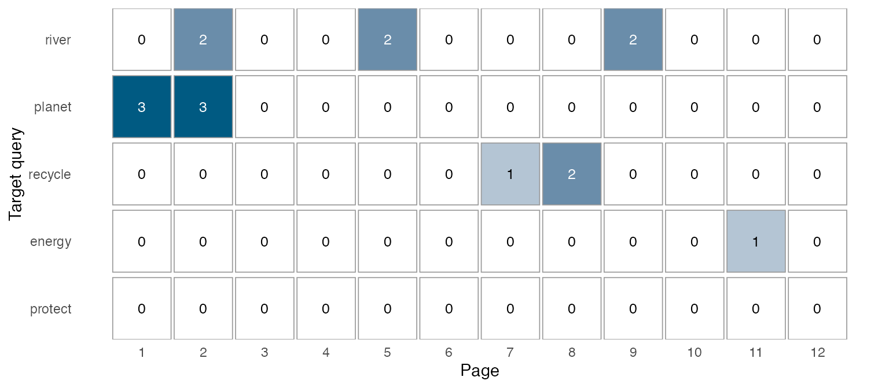
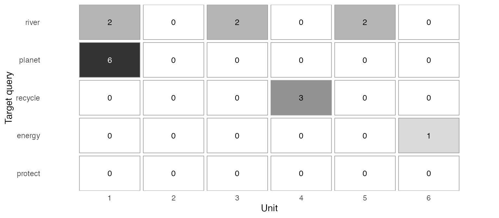

# Trace target vocabulary through textbook pages and units

A word can occur six times in one opening unit or return in three
different units. Total frequency cannot distinguish those arrangements.
This guide asks **where selected words occur, and whether they return
after their declared teaching unit**. It connects saved concordance
matches to a book’s section roster, then displays counts without losing
absent targets or unobserved parts.

Use optional **quanteda \>= 4.5.0** for searching, and **ggplot2** for
drawing. See the [installation
instructions](https://ryuya-dot-com.github.io/ldfreq/index.html#install).
The two helpers in `examples/textbook-progression.R` are explicitly
sourced installed examples, not exported functions. The script also
loads the unchanged concordance helpers.

## Begin with an inspectable example

``` r
library(ldfreq)
demo <- new.env(parent = globalenv())
sys.source(system.file("examples", "textbook-progression-demo.R",
  package = "ldfreq", mustWork = TRUE), demo)
helper <- demo$helper
x <- demo$progression
x$summary[c("query_id", "occurrences", "first_observed_page",
  "last_observed_page", "observed_units_with_hits")]
#>   query_id occurrences first_observed_page last_observed_page
#> 1    river           6                   2                  9
#> 2   planet           6                   1                  2
#> 3  recycle           3                   7                  8
#> 4   energy           1                  11                 11
#> 5  protect           0                  NA                 NA
#>   observed_units_with_hits
#> 1                        3
#> 2                        1
#> 3                        1
#> 4                        1
#> 5                        0
```

These are authored texts for a 12-page, six-unit book, not actual
textbook observations or learner outcomes. `river` and `planet` both
occur six times. `river` occurs in Units 1, 3 and 5; `planet` occurs
only in Unit 1. `protect` is a declared target with no occurrences. Page
10 is a known blank page. The example explicitly supplies lowercase
lemmas and maps `recycled` to `recycle`; it does not run an automatic
lemmatizer.

``` r
helper$textbook_progression_plot(x, by = "page")
```



Each cell gives a count of saved matches. The default is colour; use
`monochrome = TRUE` for a grey scale with the same numeric labels. Zero
means no matches within the selected, completely observed scope. `NA`
means the exact count is unknown. An em dash means that no section on
that page was selected, whose contribution to the selected-scope total
is zero. Place figure numbers, titles and explanatory notes outside the
plot. Use a selected target list and an appropriate output width for
long books; the helper does not paginate or automatically suppress
labels.

``` r
helper$textbook_progression_plot(x, by = "unit", monochrome = TRUE)
```



The Unit view makes the same counts readable at a coarser scale. For a
cumulative count at each page or Unit, set `cumulative = TRUE`. This
displays counts, not a learning curve. The exact cumulative total
becomes `NA` from the first incomplete selected part onward;
`observed_cumulative` in the table retains the known-match lower bound
without presenting it as the exact total.

## Supply your own book, order and target list

First prepare complete source-aligned annotations and call
`concordance_search()` as shown in [concordance and
dispersion](https://ryuya-dot-com.github.io/ldfreq/articles/concordance-and-dispersion.md).
Use one document ID for one book, with a segment for each declared
section. Include punctuation in the annotation input before applying a
search selection. Do not replace missing text with an empty string.
Import only the observed sections; list the unobserved sections in the
separate roster below.

| Table or argument | Required information |
|----|----|
| `search` | One unchanged concordance result for exactly one book. Patterns, lexical unit, exclusions, original text and occurrence IDs remain attached. |
| `sections` | One row per declared section: `document_id`, unique `segment_id`, positive whole-number `page` and `unit`, nonblank `role`, and logical `observed`. Rows follow page and Unit order. Multiple sections on a page are allowed; a page belongs to one Unit. |
| `targets` | One row for every saved `query_id`, including absent targets, and `introduction_unit`: a Unit in the roster or numeric `NA` when unknown. Row order sets the displayed target order. |
| `include` | One logical value per section, without missing values. The default includes all sections; an explicit mask can select body text, exercises or another declared scope. |

All and only `observed = TRUE` rows must match the saved source
segments, including their original order. Unobserved rows have no source
segment. Declare the complete intended page/section inventory: the
helper cannot detect omitted pages, OCR errors or an incomplete
inventory from the text alone. Page/Unit numbers are ordering
coordinates, not automatically extracted printed labels. Store edition,
volume, printed labels, original files and actual teaching dates
alongside the analysis when needed.

``` r
helper <- new.env(parent = globalenv())
sys.source(system.file("examples", "textbook-progression.R",
  package = "ldfreq", mustWork = TRUE), helper)

# search was created from your complete observed source annotations.
progression <- helper$textbook_progression(search, sections, targets,
  include = sections$role %in% c("body", "exercise"))
helper$textbook_progression_plot(progression, by = "unit")
```

Use the supplied surface, lemma or another justified annotation as the
search unit. A word-family search needs an explicitly supplied mapping
and a suitable query; it is not inferred from spelling. Preserve the
mapping and its source. The existing search also supports multi-token
queries. Matches cannot cross section boundaries, so dividing the text
at each page will exclude a phrase split across a page break. This
limitation must suit the intended analysis. Overlapping or duplicated
query patterns are counted separately; summing different queries is not
unique-word coverage.

The default `max_cells = 1e6` bounds the combined page-by-query and
Unit-by-query tables before allocating them. The search has its own
allocation limits. Neither bound guarantees a particular memory
footprint or readable plot size.

## Distinguish absence, missingness and excluded sections

Suppose an exercise on page 7 has not been transcribed:

``` r
s <- demo$sections
missing_exercise <- s[7, ]
missing_exercise$segment_id <- "p07-exercise"
missing_exercise$role <- "exercise"
missing_exercise$observed <- FALSE
missing_exercise$text <- NA_character_
s <- rbind(s[1:7, ], missing_exercise, s[8:12, ])
incomplete <- helper$textbook_progression(demo$search, s, demo$targets)
subset(incomplete$pages, query_id == "recycle" & page >= 7,
  select = c(page, observed_occurrences, occurrences, cumulative, status))
#>    page observed_occurrences occurrences cumulative     status
#> 31    7                    1          NA         NA incomplete
#> 32    8                    2           2         NA         ok
#> 33    9                    0           0         NA         ok
#> 34   10                    0           0         NA         ok
#> 35   11                    0           0         NA         ok
#> 36   12                    0           0         NA         ok
```

One occurrence is known on page 7, but the page total is unknown because
the exercise is missing. The helper retains that known occurrence and
its original context. Unit 4 and the whole-book exact total are also
unknown. The observed counts are lower bounds under the saved matching
and annotation conditions, not estimates of how many words would be
found after correcting OCR or lemmas.

Missing or blank search annotations on retained tokens also make a
selected section incomplete. A deliberately excluded token is different:
it defines the search scope and does not by itself create missingness.
An unobserved section excluded by the explicit section mask does not
invalidate the selected scope either:

``` r
body <- helper$textbook_progression(demo$search, s, demo$targets,
  include = s$role == "body")
stopifnot(identical(body$summary$occurrences, x$summary$occurrences))
```

These counts now describe body text only. They do not establish the
absence of additional practice elsewhere. Keep vocabulary boxes,
instructions, answer keys and indexes identifiable so that repeated
printed words are not silently treated as equivalent learning
activities.

## Assess recurrence after a declared introduction

``` r
x$summary[c("query_id", "introduction_unit", "later_units",
  "complete_later_units", "later_occurrences", "later_unit_coverage", "later_status")]
#>   query_id introduction_unit later_units complete_later_units later_occurrences
#> 1    river                 1           5                    5                 4
#> 2   planet                 1           5                    5                 0
#> 3  recycle                 4           2                    2                 0
#> 4   energy                 6           0                    0                NA
#> 5  protect                 2           4                    4                 0
#>   later_unit_coverage   later_status
#> 1                 0.4             ok
#> 2                 0.0             ok
#> 3                 0.0             ok
#> 4                  NA no_later_units
#> 5                 0.0             ok
```

The reference point is the caller’s **teaching introduction**, not
automatically the first occurrence. Later units are units strictly after
it that have at least one selected section. Thus within-Unit repetitions
and later-Unit recurrence are distinct. `later_unit_coverage` is the
proportion of those later units with at least one saved match,
calculated only when every such unit is complete. It is descriptive
coverage, not a recycling-quality score.

In the example, `river` appears four times in two of the five later
units. `planet` has five observable later units but no further
occurrences. `energy` is introduced in the last unit: its later-unit
count is zero and coverage is `NA` with `no_later_units`, not a failed
recycling score. An unknown introduction produces
`unknown_introduction`; missing material in the later scope produces
`incomplete_later_units`. Missingness confined to the introduction unit
need not invalidate the separate later scope.

`first_observed_page` and `last_observed_page` are the bounds of known
matches. If some material is missing, they need not be the actual first
and last occurrences. Different page or Unit lengths affect
opportunities to encounter words. Keep raw encounter counts for this
question; comparing lexical concentration additionally requires
explicitly defined exposure denominators. The existing within-document
DP partitions original token slots, not these page/Unit boundaries, and
is not a substitute for the progression display.

## Return from counts to the original uses

``` r
subset(x$occurrences, query_id == "river" & included & unit > 1,
  select = c(occurrence_id, page, unit, role, pre, keyword, post))
#>                                                      occurrence_id page unit
#> 3 ef2e4be9fd08c67d352c77c2c28ff5b06a9dbcef31d2d6153153d80644c7ccc6    5    3
#> 4 57853e4216a59bc8ce5e472f1bd3a1e8db9422160e81ba1792e150e8ffaebb3a    5    3
#> 5 f70c273d3c0158cf258715b8f91822805af10960f8a67b91d0dc9dc5d0bd43a0    9    5
#> 6 02aa75c75c39a1ebf5ea43e7a52fc18cc2b8ace57d30e56fc5b2a2509105497c    9    5
#>   role                  pre keyword              post
#> 3 body                 The    river      is clean. We
#> 4 body      . We cross the    river                 .
#> 5 body                 The    river  reaches the sea.
#> 6 body Birds live near the    river                 .
```

The table retains all saved occurrences with an `included` flag; filter
that flag when explaining a displayed count. Original segment IDs,
character spans, contexts and occurrence IDs are unchanged. Reading
those contexts can separate the same sentence repeated from different
senses, collocations or tasks. Further pedagogical coding is a separate
recorded judgment.

Repeated printed appearances indicate opportunities in the selected
material, not actual learner exposure, successful retrieval or
vocabulary acquisition. Page gaps do not measure elapsed teaching time.
Neither a fixed repetition threshold nor a widely spread pattern
establishes effective spiral instruction; the material, tasks and
learning evidence must support that interpretation.

## Save and reopen without rerunning the search

``` r
record <- list(progression = x, session = utils::sessionInfo())
saved <- tempfile(fileext = ".rds") # Use a lasting private path for research data.
saveRDS(record, saved)
restored <- readRDS(saved)
stopifnot(identical(restored, record))
```

Keep the full record, including original text, roster, introduction
choices, queries and inclusion mask. The plot checks the saved record’s
integrity and does not tokenize or search again. In a fresh R session:

``` r
library(ldfreq)
helper <- new.env(parent = globalenv())
sys.source(system.file("examples", "textbook-progression.R",
  package = "ldfreq", mustWork = TRUE), helper)
record <- readRDS("textbook-record.rds") # Your actual saved path.
record$progression$summary
helper$textbook_progression_plot(record$progression, by = "unit")
```

Reopening tables requires ldfreq’s required packages; drawing also
requires ggplot2. No new quanteda search, parser or model is needed.
Preserve the original calculation session rather than replacing its
versions with those of the reopening session. Fingerprints detect
accidental record changes; they do not validate the correctness of
source transcriptions, lemmas or teaching metadata.
